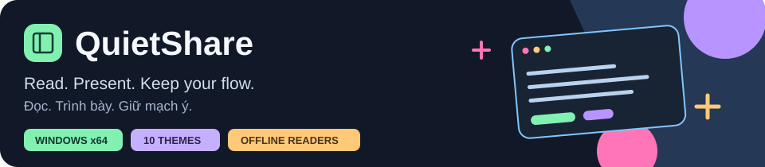
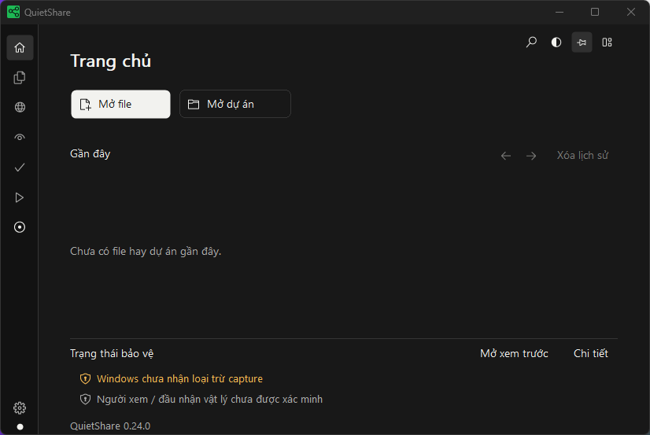
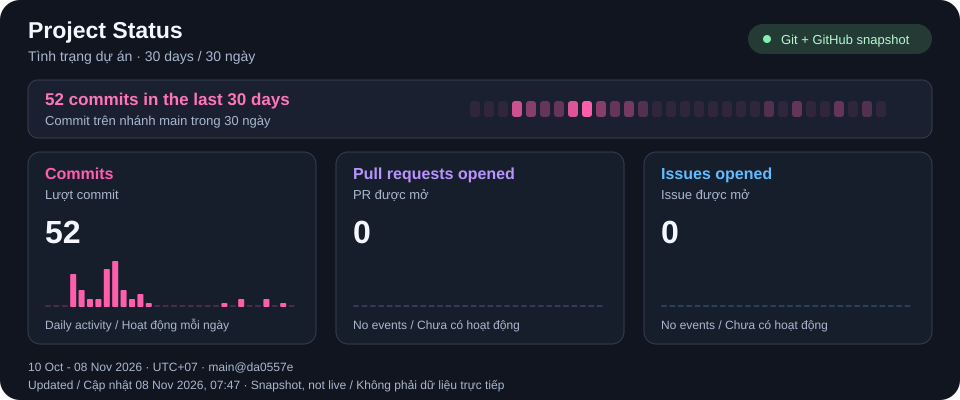

# QuietShare

A Windows companion for scripts, documents and web browsing. Smart Mirror sends public content to a second Extend display while excluding QuietShare from the verified capture path.

Ứng dụng Windows đọc lời nhắc, tài liệu và web. Smart Mirror chiếu nguồn công khai sang màn hình Extend thứ hai, loại QuietShare khỏi đường capture đã xác minh.

**Visual guides / Hướng dẫn bằng ảnh:** [English](docs/VISUAL_GUIDE_EN.md) · [Tiếng Việt](docs/VISUAL_GUIDE_VI.md).

**[Download the latest release](https://github.com/TDUmii/QuietShare/releases/latest) · [User guide](docs/USER_GUIDE.md)**

**[Tải bản mới nhất](https://github.com/TDUmii/QuietShare/releases/latest) · [Hướng dẫn sử dụng](docs/USER_GUIDE.md)**

## 🚀 Get started / Bắt đầu

1. Run **QuietShare-Setup.exe** or extract the complete portable ZIP. Uses local per-user data.

   Chạy **QuietShare-Setup.exe** hoặc giải nén toàn bộ ZIP portable. Dữ liệu lưu cục bộ theo tài khoản.

2. Wait for verification, then open files with **Ctrl+O** or folders with **Ctrl+Shift+O**. Use the sidebar to switch files or prepare a script.

   Chờ xác minh rồi mở file bằng **Ctrl+O** hoặc thư mục bằng **Ctrl+Shift+O**. Dùng thanh bên để chuyển file hoặc chuẩn bị lời nhắc.

3. Set Windows to **Extend**, choose source and destination in **Settings > Projection**, then select **Verify WGC** before **Start projection**. Preview can be disabled and remembers the choice. Inspect the real audience output.

   Đặt Windows ở **Extend**, chọn nguồn và đích trong **Cài đặt > Trình chiếu**, rồi **Kiểm tra WGC** trước khi **Bắt đầu trình chiếu**. Có thể tắt xem trước và nhớ lựa chọn. Quan sát đúng đầu nhận.

## 🎨 What you can do / Chức năng chính

- **Read and prepare:** quick switch (Ctrl+K), presentation sets, scripts, editable text/code, PDF thumbnails/bookmarks and page cues.

  **Đọc và chuẩn bị:** Home gọn, chuyển nhanh (Ctrl+K), bộ thuyết trình đã lưu, lời nhắc, sửa văn bản/code, ảnh thu nhỏ/dấu trang PDF và lời nhắc gắn trang.

- **Make it readable:** ten themes, custom colors and three usage profiles. Settings uses left categories or a compact picker. Reading tools stay beside content.

  **Dễ đọc hơn:** mười theme, màu riêng và ba hồ sơ. Cài đặt có danh mục trái hoặc nút chọn gọn. Công cụ đọc nằm cạnh nội dung.

- **Browse when needed:** optional WebView2, 8 tabs, grouped UI updates and background memory requests. Retained tabs support retry after crashes. Diagnostics has stable codes. Browsing starts disabled.

  **Duyệt web khi cần:** WebView2 tùy chọn, tối đa 8 tab, gom cập nhật giao diện và yêu cầu giảm bộ nhớ tab nền. Tab crash có thể tải lại. Chẩn đoán có mã lỗi cố định. Mở ứng dụng luôn tắt trình duyệt.

- **Record and transcribe:** optional offline Whisper (Small by default), English/Vietnamese, editable timed notes and TXT/VTT/minutes export. Import Teams/Zoom/Meet transcripts for speaker names.

  **Ghi âm và chép lời:** Whisper offline tùy chọn (mặc định Small), Anh/Việt, sửa đoạn có giờ và xuất TXT/VTT/biên bản. Nhập transcript nền tảng để giữ tên người nói.

- **Compact tabs:** independently use Tab 1, Tab 2 for documents and Browser. Hover for details.

  **Tab gọn:** bật riêng Tab 1, Tab 2 cho tài liệu và Trình duyệt. Di chuột để xem đầy đủ.

## 📊 Project Status / Tình trạng dự án

30 days: **52 commits · 0 PRs · 0 issues**. Updated **08 Nov 2026**.

30 ngày: **52 commit · 0 PR · 0 issue**. Cập nhật **08/11/2026**.

## 🛡️ Requirements and protection / Yêu cầu và bảo vệ

**Windows 10 version 2004 (build 19041) or later, or Windows 11, x64.** Smart Mirror needs two distinct Extend displays, DWM and Windows Graphics Capture. Browsing needs [Microsoft Edge WebView2 Runtime](https://developer.microsoft.com/en-us/microsoft-edge/webview2/).

**Windows 10 phiên bản 2004 (build 19041) trở lên hoặc Windows 11, x64.** Smart Mirror cần hai màn hình Extend khác nhau, DWM và Windows Graphics Capture. Duyệt web cần [Microsoft Edge WebView2 Runtime](https://developer.microsoft.com/en-us/microsoft-edge/webview2/).

**Windows accepting capture exclusion does not verify what the audience sees.**

**Windows nhận loại trừ capture không có nghĩa hình ảnh phía người xem đã được xác minh.**

- Duplicate mode locks private content. / Duplicate khóa nội dung riêng.
- Failed protection checks stop projection. Start again after recovery. / Kiểm tra bảo vệ thất bại sẽ dừng chiếu. Hãy chủ động bắt đầu lại sau khi khôi phục.
- External cameras are outside this protection. / Cơ chế này không ngăn máy ảnh bên ngoài.

## 📚 Learn more / Tài liệu

| English | Tiếng Việt |
|---|---|
| [Complete manual](docs/USER_MANUAL_EN.md) · [PDF](docs/QuietShare-User-Manual-EN.pdf) | [Hướng dẫn đầy đủ](docs/USER_MANUAL_VI.md) · [PDF](docs/QuietShare-Huong-Dan-Su-Dung-VI.pdf) |
| [User guide](docs/USER_GUIDE.md) | [Hướng dẫn sử dụng](docs/USER_GUIDE.md) |
| [Privacy and projection](docs/PRIVACY.md) | [Quyền riêng tư và trình chiếu](docs/PRIVACY.md) |
| [Sharing book](docs/BOOK.md) | [Book: chia sẻ, mã lỗi](docs/BOOK.md) |
| [Troubleshooting](docs/TROUBLESHOOTING.md) | [Xử lý sự cố](docs/TROUBLESHOOTING.md) |
| [Build from source](docs/BUILDING.md) | [Biên dịch từ mã nguồn](docs/BUILDING.md) |
| [Dependencies and licenses](docs/DEPENDENCIES.md) | [Thư viện và giấy phép](docs/DEPENDENCIES.md) |
