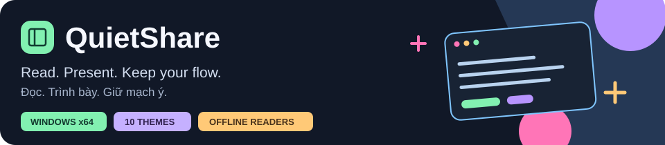
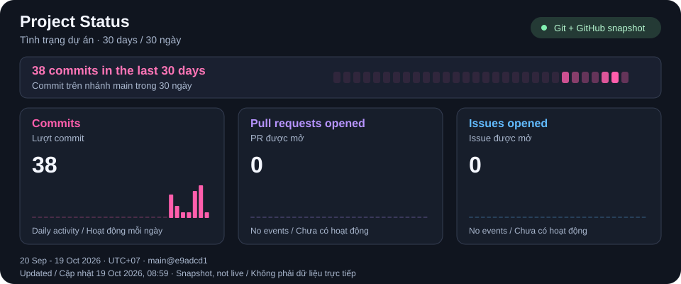

# QuietShare

A Windows presentation companion for scripts, documents and optional web browsing. Smart Mirror sends your public source display to a second Extend display while excluding QuietShare from the verified capture path.

Ứng dụng Windows hỗ trợ đọc lời nhắc, tài liệu và nội dung web khi thuyết trình. Smart Mirror chiếu màn hình nguồn công khai sang màn hình Extend thứ hai, đồng thời loại QuietShare khỏi đường capture đã xác minh.

**[Download the latest release](https://github.com/TDUmii/QuietShare/releases/latest) · [User guide](docs/USER_GUIDE.md)**

**[Tải bản mới nhất](https://github.com/TDUmii/QuietShare/releases/latest) · [Hướng dẫn sử dụng](docs/USER_GUIDE.md)**

## 🚀 Get started / Bắt đầu

1. Run **QuietShare-Setup.exe** or extract the complete portable ZIP. Both keep the app local to the current user.

   Chạy **QuietShare-Setup.exe** hoặc giải nén toàn bộ ZIP portable. Cả hai cách đều dùng dữ liệu cục bộ của tài khoản hiện tại.

2. Wait for verification, then open files with **Ctrl+O** or folders with **Ctrl+Shift+O**. Use the sidebar to switch files or prepare a script.

   Chờ xác minh rồi mở file bằng **Ctrl+O** hoặc thư mục bằng **Ctrl+Shift+O**. Dùng thanh bên để chuyển file hoặc chuẩn bị lời nhắc.

3. Set Windows to **Extend**, choose source and destination in **Settings > Projection**, then select **Verify WGC** before **Start projection**. Inspect the real audience output.

   Đặt Windows ở **Extend**, chọn nguồn và đích trong **Cài đặt > Trình chiếu**, rồi **Kiểm tra WGC** trước khi **Bắt đầu trình chiếu**. Quan sát đúng đầu nhận.

## 🎨 What you can do / Chức năng chính

- **Read and prepare:** auto-scroll scripts, editable text/code, image/PDF viewers, local folders and real recent-file history.

  **Đọc và chuẩn bị:** lời nhắc cuộn tự động, sửa văn bản/code, xem ảnh/PDF, duyệt thư mục và lịch sử file thật.

- **Make it readable:** 10 themes, word wrap, text size and weight, focus mode and adjustable layout. Change them in **Settings > Appearance** or the viewer toolbar.

  **Dễ đọc hơn:** 10 theme sáng/tối/tương phản cao, xuống dòng, cỡ và độ đậm chữ, chế độ tập trung và bố cục tùy chỉnh. Đổi theme trong **Cài đặt > Giao diện** hoặc thanh công cụ xem tệp.

- **Browse when needed:** optional WebView2 browser with up to 8 tabs. File readers work offline. Browsing starts disabled.

  **Duyệt web khi cần:** trình duyệt WebView2 tùy chọn, tối đa 8 tab. Trình đọc file dùng offline. Trình duyệt luôn tắt khi mới mở ứng dụng.

- **Record and transcribe:** save Windows playback to WAV, then run local Vietnamese or English Windows Speech API. No microphone or auto-start.

  **Ghi âm và chép lời:** lưu âm thanh Windows thành WAV, rồi chạy Speech API cục bộ bằng tiếng Việt hoặc tiếng Anh. Không micro, không tự ghi.

- **Shorten tab labels:** choose numbered labels independently for Lời nhắc/file tabs and Browser tabs. Tooltips keep the full path or address.

  **Rút gọn nhãn tab:** chọn riêng nhãn Tab 1, Tab 2 cho tab Lời nhắc/file và Browser. Tooltip vẫn giữ đường dẫn hoặc địa chỉ.

## 📊 Project Status / Tình trạng dự án

30 days: **38 commits · 0 PRs · 0 issues**. Updated **19 Oct 2026**.

30 ngày: **38 commit · 0 PR · 0 issue**. Cập nhật **19/10/2026**.

## 🛡️ Requirements and protection / Yêu cầu và bảo vệ

**Windows 10 version 2004 (build 19041) or later, or Windows 11, x64.** Smart Mirror needs two distinct Extend displays, working DWM and Windows Graphics Capture. Browsing additionally requires [Microsoft Edge WebView2 Runtime](https://developer.microsoft.com/en-us/microsoft-edge/webview2/).

**Windows 10 phiên bản 2004 (build 19041) trở lên hoặc Windows 11, x64.** Smart Mirror cần hai màn hình Extend khác nhau, DWM và Windows Graphics Capture hoạt động. Duyệt web cần [Microsoft Edge WebView2 Runtime](https://developer.microsoft.com/en-us/microsoft-edge/webview2/).

**Windows accepting capture exclusion does not verify what the audience sees.**

**Windows nhận loại trừ capture không có nghĩa hình ảnh phía người xem đã được xác minh.**

- Duplicate mode locks private content. / Duplicate khóa nội dung riêng.
- Failed protection checks stop projection. Start it again after recovery. / Kiểm tra bảo vệ thất bại sẽ dừng chiếu. Hãy chủ động bắt đầu lại sau khi khôi phục.
- External cameras are outside this protection. / Cơ chế này không ngăn máy ảnh bên ngoài.

## 📚 Learn more / Tài liệu

| English | Tiếng Việt |
|---|---|
| [Complete manual](docs/USER_MANUAL_EN.md) · [PDF](docs/QuietShare-User-Manual-EN.pdf) | [Hướng dẫn đầy đủ](docs/USER_MANUAL_VI.md) · [PDF](docs/QuietShare-Huong-Dan-Su-Dung-VI.pdf) |
| [User guide](docs/USER_GUIDE.md) | [Hướng dẫn sử dụng](docs/USER_GUIDE.md) |
| [Privacy and projection](docs/PRIVACY.md) | [Quyền riêng tư và trình chiếu](docs/PRIVACY.md) |
| [Sharing book](docs/BOOK.md) | [Book: chia sẻ, mã lỗi](docs/BOOK.md) |
| [Troubleshooting](docs/TROUBLESHOOTING.md) | [Xử lý sự cố](docs/TROUBLESHOOTING.md) |
| [Build from source](docs/BUILDING.md) | [Biên dịch từ mã nguồn](docs/BUILDING.md) |
| [Dependencies and licenses](docs/DEPENDENCIES.md) | [Thư viện và giấy phép](docs/DEPENDENCIES.md) |

Close QuietShare before upgrading. Use the installer or complete portable ZIP. / Đóng QuietShare trước khi nâng cấp. Dùng bộ cài hoặc toàn bộ ZIP portable.
