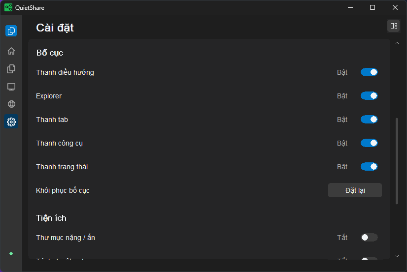
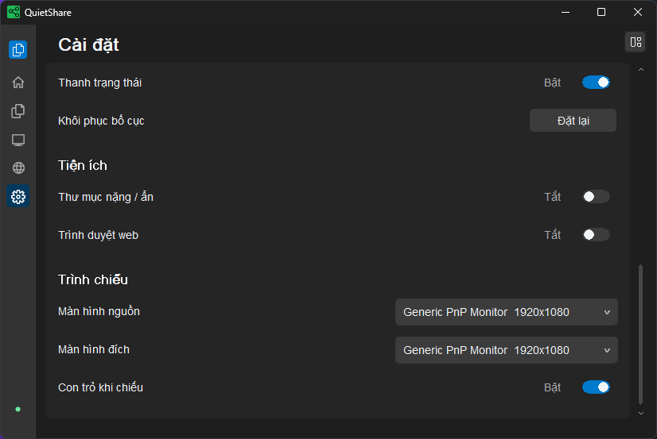
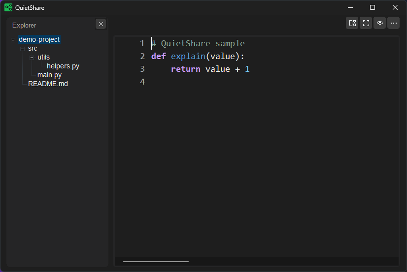

# QuietShare 0.7.0

QuietShare là ứng dụng desktop để đọc lời nhắc, xem code, ảnh và PDF trong một cửa sổ riêng khi thuyết trình. Các trình đọc file chạy offline trên Windows 10/11 x64; có thể bật trình duyệt web khi cần. App hỗ trợ tiếng Việt và tiếng Anh.

QuietShare is a Windows 10/11 x64 desktop app for private scripts, code, images and PDFs during presentations. File readers work offline, with an optional browser for web access. It supports Vietnamese and English.

## Tiếng Việt

### Tính năng

- **Nhiều tab**: mở nhiều file hoặc kéo thả một nhóm file; giữ scroll, zoom và trang PDF theo tab. Lời nhắc có tab riêng, không bị file xem trước ghi đè. Tối đa 32 tab, gồm lời nhắc.
- **Code có màu cú pháp**: số dòng, monospace, giữ thụt dòng, chọn/sao chép, tìm kiếm và xuống dòng tùy chọn. Lexer hỗ trợ Python, C/C++, C#, Java, JavaScript/TypeScript, HTML, CSS, JSON, XML, YAML, Markdown, SQL, Bash/PowerShell, Rust và Go. Code chỉ được xem, không thực thi.
- **Explorer luôn sẵn có**: thư mục đã mở vẫn nằm cạnh nội dung khi chọn file, đổi tab hoặc thu nhỏ cửa sổ. Kéo đường phân cách để chỉnh độ rộng; ẩn/hiện bằng Ctrl+B. Mặc định bỏ qua thư mục ẩn và `.git`, `node_modules`, `.venv`, `dist`, `build`; đổi bộ lọc trong Cài đặt.
- **Trình duyệt tùy chọn**: nhập địa chỉ HTTP/HTTPS, tên miền, `localhost` có cổng hoặc từ khóa để tìm Google. Có nút Google, ChatGPT, quay lại, tiến tới và tải lại; mặc định tắt khi khởi động. Hồ sơ đăng nhập riêng của QuietShare được giữ trên máy.
- **PDF trong app**: xem từng trang, vừa khung/vừa chiều ngang, zoom 25-400%, chọn/sao chép và tìm chữ khi có lớp văn bản. PDF scan vẫn xem được; PDF có mật khẩu chưa được hỗ trợ.
- **Lời nhắc và ảnh**: tự lưu lời nhắc bằng Windows DPAPI, soạn/đọc và cuộn ở ba tốc độ; ảnh có zoom và kéo để di chuyển.
- **Cài đặt tập trung**: ngôn ngữ, ghim, cỡ chữ/zoom nhập tay, tốc độ lời nhắc, xuống dòng code, bố cục, thư mục, trình duyệt và màn hình chiếu trong một form cuộn có nhóm rõ ràng. Tab tự đưa mục đang chọn vào vùng nhìn thấy.
- **Bố cục tùy chỉnh**: nút **Bố cục** ở góc trên bên phải bật/tắt riêng thanh icon, Explorer, tab, công cụ và trạng thái. App nhớ độ rộng Explorer cùng các lựa chọn trên máy; có lệnh khôi phục bố cục mặc định. F11 ẩn các thanh và giữ những nút cần thiết.
- **Smart Mirror**: đưa hình ảnh công khai từ màn hình nguồn lên màn hình đích ở chế độ Extend, sau khi kiểm tra capture thực tế đạt.
- Giao diện tối với góc bo nhẹ, ghim trên cùng, che nhanh F8 và VI/EN trong app và bộ cài.
- Thanh bên chỉ hiện icon; giữ chuột trên icon để xem tên. Menu công cụ có nền tối, icon và phím tắt căn phải; mở menu vẫn giữ được kiểm tra WGC.

Văn bản/code hỗ trợ UTF-8 hoặc UTF-16 có BOM, tối đa 5 MiB. App nhận TXT, MD, LOG, C/C++, PY, JS/TS, HTML/CSS, JSON/XML/YAML, SQL, SH/PS1, RS, GO và một số định dạng code khác. File không có phần mở rộng hoặc định dạng chưa nhận diện được xem dưới dạng văn bản monospace đơn sắc nếu encoding hợp lệ và không có dữ liệu nhị phân; tệp thực thi, gói cài đặt và các định dạng nhị phân như BIN/ZIP bị từ chối. Ảnh nhận PNG, JPG/JPEG, BMP và khung đầu của GIF, tối đa 25 MiB/40 megapixel. PDF tối đa 64 MiB. File và thư mục phải nằm trên ổ đĩa cục bộ.

### Cài đặt

1. Cần **Windows 10 phiên bản 2004 (build 19041) trở lên hoặc Windows 11, x64**, với DWM và Windows Graphics Capture hoạt động.
2. Tải [QuietShare 0.7.0](https://github.com/TDUmii/QuietShare/releases/tag/v0.7.0), giải nén toàn bộ gói và chạy `QuietShare-Setup.exe`. Bộ cài dùng tài khoản hiện tại, không cần quyền quản trị.
3. Để dùng portable, chạy `QuietShare.exe` trong thư mục đã giải nén. Giữ `Scintilla.dll`, `Lexilla.dll`, `pdfium.dll` và `WebView2Loader.dll` cạnh EXE; không chỉ sao chép riêng EXE.

Để dùng web, máy cần **Microsoft Edge WebView2 Evergreen Runtime** hiện hành. Nếu trình duyệt không mở được, cài/cập nhật từ [Microsoft WebView2](https://developer.microsoft.com/en-us/microsoft-edge/webview2/), rồi tắt/bật trình duyệt lại. Các chức năng đọc file vẫn dùng được khi không có runtime.

Đóng QuietShare trước khi nâng cấp bằng bộ cài mới. Nâng cấp và gỡ app giữ lại lời nhắc đã tự lưu. Nút **EN / VI** trong bộ cài đổi ngôn ngữ.

### Sử dụng

1. Đợi kiểm tra capture khi mở app. Nếu nội dung đang khóa, bấm **Kiểm tra WGC** tại **Tổng quan**; nếu cần đổi màn hình nguồn, vào **Cài đặt > Trình chiếu** trước. App kiểm tra một marker thử, không dùng nội dung cá nhân; chỉ hiện nội dung khi kiểm tra đạt.
2. Chọn **Lời nhắc** để soạn. Ctrl+Enter chuyển soạn/đọc; dùng nút chạy hoặc **⋯ > Chạy / Dừng cuộn**. **Cài đặt > Đọc nội dung > Tốc độ lời nhắc** chọn Chậm/Vừa/Nhanh. Chỉ lời nhắc được tự lưu và khôi phục khi mở lại app.
3. Dùng **Mở hoặc thả file**, Ctrl+O hoặc kéo thả nhiều file. Ctrl+Tab / Ctrl+Shift+Tab chuyển tab; dấu **×**, chuột giữa hoặc Ctrl+W đóng tab file. **⋯** có lệnh đóng tab khác/mọi file, luôn giữ lời nhắc. Mở lại file đã thay đổi sẽ có lựa chọn **Tải lại** hoặc **Giữ bản đang xem**.
4. Ctrl+Shift+O hoặc **Mở dự án** chọn thư mục. Mở rộng thư mục rồi nhấp đúp file, hoặc dùng phím mũi tên và Enter. Explorer luôn nằm cạnh nội dung, kể cả khi cửa sổ hẹp; chọn file và đổi tab giữ nguyên cây đang mở. Kéo đường phân cách giữa Explorer và nội dung để chỉnh độ rộng. **×** trên tiêu đề Explorer ẩn cây; **Ctrl+B** hoặc **Bố cục > Explorer** hiện lại với thư mục và các nhánh đang mở. Cây bỏ qua junction/symlink và giới hạn thư mục lớn; mở thư mục con riêng nếu app yêu cầu.
5. Dùng **− / +**, Ctrl+`−` / Ctrl+`+`, Ctrl rồi lăn chuột hoặc **Cài đặt > Đọc nội dung** để đổi cỡ chữ/zoom của tab đang chọn. Ctrl+`0` đưa chữ/code về cỡ mặc định, ảnh/PDF về vừa khung. Kéo ảnh hoặc dùng phím mũi tên để di chuyển.
6. Ctrl+F tìm trong lời nhắc, văn bản, code hoặc PDF có lớp chữ; Enter tìm tiếp, Shift+Enter tìm trước, Esc đóng tìm kiếm. Chọn chữ rồi Ctrl+C để sao chép. **Cài đặt > Đọc nội dung > Xuống dòng code** áp dụng cho tab code đang chọn.
7. PDF hiển thị một trang tại một thời điểm. **⋯ > Trang PDF trước / sau** hoặc Page Up / Page Down đổi trang; **⋯ > PDF vừa chiều ngang** đổi fit. Lăn chuột hoặc kéo vùng trống để di chuyển; kéo trên chữ để chọn và Ctrl+C để sao chép.
8. Nút **Bố cục** ở góc trên bên phải bật/tắt nhanh thanh icon, Explorer, tab, công cụ và thanh trạng thái; các lựa chọn này cũng có trong **Cài đặt > Bố cục**. **Khôi phục bố cục** đưa các thanh và độ rộng Explorer về mặc định; lựa chọn được lưu trên máy. F11 bật/tắt tập trung, ẩn tab và giữ các nút cần thiết; thoát F11 khôi phục thanh tiêu đề và bố cục đã chọn. Khi tab đang hiện, lăn chuột hoặc dùng mũi tên hai đầu để xem tab bị tràn; rê chuột để xem tooltip. **Ghim** giữ cửa sổ trên cùng. Kéo thanh tiêu đề hoặc vùng trống ở trên để di chuyển; kéo cạnh cửa sổ để resize. Menu **⋯** hoặc Alt+F4 đóng app. Đổi ngôn ngữ tại **Cài đặt > Hiển thị > Ngôn ngữ**.
9. F8 che mọi nội dung, tên tab và cây thư mục, đồng thời dừng cuộn và Smart Mirror. Bấm F8 để mở lại; nếu app yêu cầu xác minh, bấm **Kiểm tra WGC** trước khi tiếp tục.

Ctrl+Alt+Q gọi QuietShare lên khi bị che hoặc thu nhỏ, kể cả lúc không ghim. Phím tắt không mở Alt+Tab và giữ focus ở ứng dụng đang dùng. Nếu đang che bằng F8, nội dung vẫn được che. Rê chuột vào nút Ghim để xem trạng thái phím tắt; app khác dùng cùng tổ hợp có thể khiến đăng ký không thành công.

Mở **Cài đặt** bằng icon bánh răng hoặc **⋯ > Cài đặt**. Dùng con lăn, thanh cuộn hoặc Tab để tới từng mục; giao diện tự cuộn khi mục nhận focus nằm ngoài vùng nhìn thấy.

| Nhóm | Điều chỉnh |
|---|---|
| **Hiển thị** | Ngôn ngữ và ghim cửa sổ trên cùng. |
| **Đọc nội dung** | Nhập cỡ chữ/zoom rồi nhấn Enter; dùng **Đặt lại** để về mặc định. Lời nhắc/văn bản: 8-200 pt. Code/ảnh/PDF: 25-400%. Chọn tốc độ lời nhắc và xuống dòng code. |
| **Bố cục** | Bật/tắt riêng năm thanh, hoặc khôi phục bố cục mặc định. |
| **Tiện ích** | Hiện thư mục nặng/ẩn và bật/tắt trình duyệt. |
| **Trình chiếu** | Chọn màn hình nguồn, màn hình đích và có hiện con trỏ khi chiếu hay không. |

Hộp chọn file/dự án là cửa sổ native được bảo vệ của QuietShare. Dùng **Ổ đĩa**, **Lên**, nhấp đúp để vào thư mục; Ctrl/Shift chọn nhiều file rồi bấm **Mở**, hoặc bấm **Chọn thư mục** cho dự án. Hộp chọn chỉ duyệt ổ cục bộ, bỏ qua reparse/junction và hiện tối đa 1.000 mục mỗi thư mục.

Để dùng web: bật **Cài đặt > Tiện ích > Trình duyệt web**, chờ kiểm tra vùng WebView2 rồi chọn icon quả địa cầu. Bật tại Cài đặt giữ nguyên trang Cài đặt; nội dung web chỉ mở khi kiểm tra đạt. Cũng có thể bật/tắt ngay trên trang trình duyệt. Ô địa chỉ nhận URL như `https://example.com`, tên miền như `example.com`, địa chỉ cục bộ như `localhost:3000` hoặc từ khóa như `cách dùng C++`; nhấn Enter hoặc **Mở** để truy cập hoặc tìm Google. Nút **Google** mở trang tìm kiếm, **ChatGPT** mở `https://chatgpt.com`; đăng nhập trong trang web khi cần. Tắt trình duyệt đóng engine web, giữ cookie của hồ sơ riêng để lần sau đăng nhập thuận tiện. Chuyển sang đọc file sẽ ẩn và yêu cầu tạm ngưng web; mở lại để tiếp tục. F8 che cả web và ô địa chỉ. Thay đổi màn hình tắt web để yêu cầu kiểm tra mới.

Web trong bản này dành cho đọc và chat bằng chữ. Tải lên/tải xuống file, camera, microphone, chia sẻ màn hình, thông báo, DevTools và menu native bị tắt. Dropdown HTML native có thể chọn bằng phím mũi tên; dropdown do website vẽ vẫn dùng bình thường. Popup tự phát bị chặn; link mở cửa sổ mới do người dùng bấm chuyển vào cùng vùng web. Luồng đăng nhập OAuth cần popup riêng có thể không tương thích.

Để dùng **Smart Mirror**: chuyển **Win+P > Extend**, đặt toàn bộ QuietShare trên màn hình nguồn, vào **Cài đặt > Trình chiếu**, chọn nguồn và đích khác nhau cùng lựa chọn con trỏ. Tại trang **Trình chiếu**, xem tóm tắt hai màn hình, bấm **Kiểm tra WGC** và **Bắt đầu**; **Dừng** kết thúc chiếu. **Thiết lập màn hình** đưa thẳng tới nhóm Trình chiếu trong Cài đặt. Hai màn hình phải thuộc cùng GPU trong phiên bản này. Một màn hình vẫn có thể kiểm tra WGC để dùng cửa sổ riêng, nhưng không thể bắt đầu Smart Mirror.

**Duplicate luôn khóa nội dung riêng.** Kiểm tra thất bại, thay đổi màn hình hoặc capture mất an toàn sẽ dừng chiếu và khóa nội dung. “Windows đã nhận” xác nhận trạng thái API; “người xem chưa được xác minh” vẫn cần kiểm tra từ phía người nhận trong đúng Zoom/Meet/Teams/OBS hoặc máy chiếu sẽ dùng. Dùng nội dung mẫu trước buổi chia sẻ. Phần mềm không ngăn máy ảnh bên ngoài chụp màn hình.

## English

### Features

- **Multiple tabs**: open/drop several files and keep scroll, zoom and PDF page per tab. The permanent script remains independent of read-only previews. Up to 32 tabs, including the script.
- **Syntax-colored code**: line numbers, monospace indentation, selection/copy, find and optional wrapping. Lexers cover Python, C/C++, C#, Java, JavaScript/TypeScript, HTML, CSS, JSON, XML, YAML, Markdown, SQL, Bash/PowerShell, Rust and Go. Code is never executed.
- **Persistent Explorer**: the open folder stays beside content when opening files, switching tabs or narrowing the window. Drag the divider to resize it; use Ctrl+B to hide/show it. Hidden folders and `.git`, `node_modules`, `.venv`, `dist`, `build` are ignored by default; change the filter in Settings.
- **Optional browser**: enter an HTTP/HTTPS address, a domain, `localhost` with a port, or a Google search query. Includes Google and ChatGPT shortcuts, Back, Forward and Reload; starts disabled. QuietShare keeps its own login profile locally.
- **In-app PDFs**: page navigation, fit-page/fit-width, 25-400% zoom, selection/copy and find when a text layer exists. Image-only scans remain viewable; password-protected PDFs are unsupported.
- **Scripts and images**: local Windows DPAPI autosave, editing/reading and three auto-scroll speeds; image zoom and dragging to pan.
- **Central settings**: language, pinning, manual text size/zoom, script scrolling, code wrapping, layout, folders, browsing and presentation displays in one grouped scroll form. Tab brings the focused setting into view.
- **Custom layout**: the top-right **Layout** button independently toggles the activity bar, Explorer, tabs, toolbar and status bar. Explorer width and visibility choices are saved locally; restore the default layout at any time. F11 hides the bars while keeping essential actions available.
- **Smart Mirror**: project a public source display onto a separate destination in Extend after the actual capture preflight passes.
- Dark interface with softly rounded corners, always-on-top pinning, instant F8 hide and VI/EN app/installer interfaces.
- Icon-only navigation with delayed name tooltips. The dark tools menu includes icons and aligned shortcuts; opening it preserves WGC verification.

Text/code support UTF-8 or BOM-marked UTF-16, up to 5 MiB. Supported extensions include TXT, MD, LOG, C/C++, PY, JS/TS, HTML/CSS, JSON/XML/YAML, SQL, SH/PS1, RS, GO and selected other source formats. Extensionless or unrecognized files fall back to monochrome monospace text when their encoding is valid and they contain no binary controls; executables, installer packages and binary formats such as BIN/ZIP are rejected. Images support PNG, JPG/JPEG, BMP and the first GIF frame, up to 25 MiB/40 megapixels. PDFs are limited to 64 MiB. Files/folders must be on local drives.

### Install

1. Use **Windows 10 version 2004 (build 19041) or later, or Windows 11, x64**, with working DWM and Windows Graphics Capture.
2. Download [QuietShare 0.7.0](https://github.com/TDUmii/QuietShare/releases/tag/v0.7.0), extract the complete package and run `QuietShare-Setup.exe`. It installs for the current account without administrator rights.
3. For portable use, run `QuietShare.exe` in the extracted folder. Keep `Scintilla.dll`, `Lexilla.dll`, `pdfium.dll` and `WebView2Loader.dll` beside it; copying only the EXE is insufficient.

Web browsing requires a current **Microsoft Edge WebView2 Evergreen Runtime**. If it cannot start, install/update the runtime from [Microsoft WebView2](https://developer.microsoft.com/en-us/microsoft-edge/webview2/) and toggle the browser off/on. Offline file readers remain available without it.

Close QuietShare before upgrading with a new installer. Upgrading/uninstalling preserve the autosaved script. Use the installer's **EN / VI** button to change its language.

### Use

1. Wait for the capture check at launch. If content is locked, press **Verify WGC privacy** on **Overview**; to change the source display, open **Settings > Presentation** first. The app checks a synthetic marker without your personal content and reveals content only after success.
2. Select **Script** to prepare your notes. Ctrl+Enter switches editing/reading; use the play action or **⋯ > Start / stop scrolling**. **Settings > Reading > Script scrolling** cycles Slow/Medium/Fast. Only the script is autosaved/restored on launch.
3. Use **Open or drop a file**, Ctrl+O or multi-file drag/drop. Ctrl+Tab / Ctrl+Shift+Tab switches tabs; **×**, middle-click or Ctrl+W closes a file tab. **⋯** can close other/all file tabs while retaining the script. Reopening a changed file offers **Reload** or **Keep current preview**.
4. Ctrl+Shift+O or **Open project** selects a folder. Expand folders, then double-click a file or navigate with arrows and Enter. Explorer stays beside content even in narrow windows; opening files or switching tabs preserves the open tree. Drag the divider between Explorer and content to adjust its width. The Explorer header's **×** hides it; **Ctrl+B** or **Layout > Explorer** restores the same folder and expanded branches. Junctions/symlinks are skipped and large folders are bounded; open a subfolder separately if requested.
5. Use **− / +**, Ctrl+`−` / Ctrl+`+`, Ctrl plus the wheel, or **Settings > Reading** to adjust the active tab's text size/zoom. Ctrl+`0` restores default script/code size and fits images/PDFs. Drag images or use arrows to pan.
6. Ctrl+F opens find for scripts, text, code and PDFs with a text layer. Enter finds next, Shift+Enter previous, and Esc closes find. Select text and Ctrl+C to copy. **Settings > Reading > Wrap code** applies to the active code tab.
7. The PDF reader displays one page at a time. **⋯ > Previous / Next PDF page** or Page Up / Page Down changes pages; **⋯ > Fit PDF width** changes fit. Scroll or drag a blank area to pan; drag over text to select it, then Ctrl+C to copy.
8. The top-right **Layout** button quickly toggles the activity bar, Explorer, tabs, toolbar and status bar; the same choices appear in **Settings > Workspace**. **Reset layout** restores the default bars and Explorer width; choices are saved locally. F11 enters/exits focus, hides tabs and keeps essential actions; exiting restores the title bar and your chosen layout. When tabs are visible, scroll over the strip or use its end arrows for overflowing tabs; hover for tooltips. **Pin** keeps the window on top. Drag the title bar or blank top area to move; drag window edges to resize. Use **⋯** or Alt+F4 to close the app. Change language through **Settings > Appearance > Language**.
9. F8 hides every viewer, tab name and project tree, and stops auto-scroll and Smart Mirror. Press F8 to reveal; run **Verify WGC privacy** first if verification is requested.

Ctrl+Alt+Q recalls a covered or minimized QuietShare window, including when unpinned. It preserves the current application's focus and does not open Alt+Tab. F8-masked content remains masked. Hover the Pin button to see shortcut availability; another application's registration can occupy the same combination.

Open **Settings** with the gear icon or **⋯ > Settings**. Use the wheel, scrollbar or Tab to reach each setting; focus automatically scrolls off-screen controls into view.

| Group | Controls |
|---|---|
| **Appearance** | Language and always-on-top pinning. |
| **Reading** | Type text size/zoom and press Enter; **Reset** restores the default. Script/text: 8-200 pt. Code/images/PDF: 25-400%. Choose script scrolling speed and code wrapping. |
| **Workspace** | Independently toggle the five supporting bars or reset the layout. |
| **Tools** | Include heavy/hidden folders and enable/disable browsing. |
| **Presentation** | Select the source display, destination and whether to show the pointer. |

The file/project picker is a capture-protected QuietShare native window. Use **Drives**, **Up**, and double-click to enter a folder; Ctrl/Shift selects multiple files, then **Open**, or use **Select folder** for a project. It browses local drives, skips reparse/junction entries and displays up to 1,000 entries per folder.

For web: enable **Settings > Tools > Web browser**, wait for the rendered WebView2 capture check, then choose the globe icon. Enabling it in Settings keeps Settings open; web content is available only after the check passes. Browsing can also be toggled from the browser page. The address field accepts URLs such as `https://example.com`, domains such as `example.com`, local addresses such as `localhost:3000`, and search terms such as `C++ examples`; press Enter or **Go** to navigate or search Google. **Google** opens the search page; **ChatGPT** opens `https://chatgpt.com`. Sign in on the page when needed. Disabling browsing closes the web engine while retaining its separate profile cookies. Switching to file reading hides the browser and requests suspension; return to resume. F8 hides web content and its address. A display change closes web browsing until a fresh check.

This browser is for reading and text chat. File uploads/downloads, camera, microphone, screen sharing, notifications, DevTools and native context menus are disabled. Native HTML selects support arrow-key selection; website-rendered dropdowns remain usable. Unsolicited popups are blocked; user-initiated new-window links navigate in the same protected view. OAuth flows requiring a separate popup may be incompatible.

For **Smart Mirror**, choose **Win+P > Extend**, place the entire QuietShare window on the source display, then open **Settings > Presentation** to select different source/destination displays and the pointer setting. On the **Presentation** page, review the display summary, press **Verify WGC privacy** and **Start**; **Stop** ends projection. **Display settings** jumps directly to the Presentation group in Settings. Both displays must use the same GPU in this version. A single display can run the WGC preflight for private-window use but cannot start Smart Mirror.

**Duplicate always locks private content.** Failed checks, changed displays or unsafe capture stop projection and lock the readers. “Windows accepted” confirms the API state; “Viewer unverified” still requires a receiver-side check in the actual Zoom/Meet/Teams/OBS or projector setup. Use sample content before sharing. Software cannot prevent an external camera from filming the screen.
