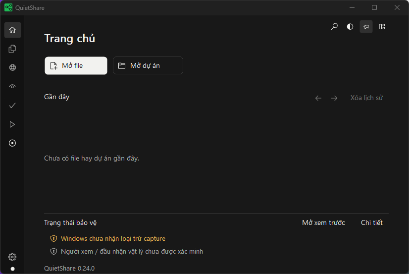

# QuietShare User Manual

> **Illustrated walkthrough:** [8 real UI screenshots with numbered red click targets](VISUAL_GUIDE_EN.md).

English edition - QuietShare v0.23.0

Read, prepare and present with private notes on Windows.

[PDF edition](QuietShare-User-Manual-EN.pdf) | [Vietnamese edition](USER_MANUAL_VI.md) | [Latest release](https://github.com/TDUmii/QuietShare/releases/latest)

## 1. Start here

QuietShare is a desktop companion for reading scripts, local documents and optional web pages while presenting. Its private control window is separate from the material you intend to show an audience.

Smart Mirror captures the selected public source display and renders it on a second display. It checks that QuietShare is excluded from the verified capture path before allowing private content. A successful check describes that local capture path. You still need to inspect the actual projector, television, meeting receiver or recording.

### Choose your workflow

- **Read on one display:** open a local file or prepare a script after capture verification. Smart Mirror is not required.
- **Present to a projector or monitor:** use Windows Extend with two distinct displays on the same GPU. Follow chapter 10.
- **Present to a wireless TV:** first establish a separate Windows display. Follow chapter 11.
- **Share in a meeting:** share the original public application through the meeting application's controls. Follow chapter 12.
- **Record in OBS:** choose and test the actual public capture source. Follow chapter 12.

Do not select the private QuietShare window as your public material. F8 masks private content and stops QuietShare projection. It does not end a meeting application's screen share or an OBS recording.

### Requirements

- Windows 10 version 2004, build 19041 or later, or Windows 11.
- A 64-bit Windows installation.
- Working Desktop Window Manager (DWM) and Windows Graphics Capture (WGC).
- For Smart Mirror, two distinct Extend displays identified on the same graphics adapter.
- For optional browsing, Microsoft Edge WebView2 Runtime.

Local file readers work offline and do not require the browser engine. Cross-adapter projection is not supported. Duplicate mode locks private content.

### A short first session

1. Install QuietShare or extract the complete portable package.
2. Open the application and wait for capture verification.
3. Read the protection status. If locked, address the displayed condition before opening private notes.
4. Open a harmless text file with Ctrl+O.
5. Adjust text size, weight and word wrap to suit the laptop.
6. Test F8 to learn the mask control before presenting.
7. For an audience workflow, complete its chapter and inspect the real receiver with sample content.

The projection Play control and the reader's auto-scroll Play control have different purposes. F10 starts or stops Smart Mirror. Space starts or pauses scrolling in the reading area.

## 2. Install, update and uninstall

Download from the [QuietShare release page](https://github.com/TDUmii/QuietShare/releases/latest). Use the current release assets together. Do not combine an executable from one release with libraries from another.

### Install for the current user

1. Close an older running copy of QuietShare.
2. Download **QuietShare-Setup.exe**.
3. Run the installer and choose English or Vietnamese.
4. Complete the installation for your Windows account. Administrator access is not required.
5. Launch QuietShare and confirm the version on Home.

Windows may apply its usual downloaded-application checks. Use the release from the project's repository and follow your organization's software policy.

### Use the portable package

1. Download the complete versioned Windows x64 ZIP.
2. Extract it to a normal local folder before running the program.
3. Keep these files together:
   - QuietShare.exe
   - Scintilla.dll
   - Lexilla.dll
   - pdfium.dll
   - WebView2Loader.dll
4. Keep the included documentation and license files with the package.
5. Run QuietShare.exe from the extracted folder.

Running only the EXE, or opening it directly inside a ZIP viewer, is not a complete portable installation.

### Update

1. Save modified text or code files.
2. Stop projection and close QuietShare.
3. For an installed copy, run the new installer.
4. For portable use, extract the complete new package into a separate folder and run that copy.
5. Confirm the new version on Home.
6. Recheck the actual audience output before the next private presentation.

Saved scripts are preserved by installation updates. Keep a separate copy of important source material as part of your normal backup practice.

### Uninstall

1. Save your work and close QuietShare.
2. For an installed copy, open Windows installed-app settings and uninstall QuietShare.
3. For a portable copy, remove its extracted application folder after closing it.

Uninstalling does not erase saved scripts or all local user data. Portable use also stores preferences and scripts in the Windows user profile. Removing the portable application folder does not clear that profile. Clear recent history separately in QuietShare when that is your intention.

## 3. Home and your workspace

Home provides quick access to files and project folders you have actually opened. It does not insert demonstration recent files into your history.

The compact **Home** header includes a primary **Open file** button and an outlined **Open project** button. Recent work uses a flat list across the available width, with protection status in its own section. The compact icon rail uses tooltips to identify each workspace. File, PDF and browser toolbars and tabs use matching flat controls.

The illustration shows the Home layout. Your version, language, recent entries and protection results can differ.

### Open recent work

1. Return to **Overview** on the sidebar.
2. Find the file or project in Recent Files.
3. Select the entry to reopen it.
4. Use the previous or next page controls when more entries are available.

Reopening requires the original local file or folder to remain available. A recent entry is a shortcut to that location, not an embedded backup.

### Pin or remove an entry

- Select the pin control beside an entry to keep it among favorites.
- Select it again to unpin it.
- Use the remove control beside an entry to delete that history entry.
- Select **Clear history** to remove all recent entries, including pins.

These actions do not delete the original files or folders. Removing history does not close an already open document.

### Navigate the sidebar

- **Overview** returns to Home.
- **Open files** returns to the active document.
- Right-click **Open files** to switch to another open file or compose a script.
- **Browser** opens the optional browsing workspace.
- **Verify WGC** runs capture verification. The projection Play or Stop control starts or stops Smart Mirror.
- **Settings** groups appearance, reading/files, projection, browser, meetings, workspace, shortcuts and data.

Use tooltips to identify compact icon controls. For a small laptop display, hide unneeded bars through Layout or use F11 focus mode.

### Open a project folder

1. Choose **Open project** or press Ctrl+Shift+O.
2. Select a local folder in the protected picker.
3. Expand its folders in Explorer.
4. Double-click a file or select it and press Enter.
5. Use Ctrl+B to hide or reveal Explorer.

Explorer skips junctions and symbolic links. Hidden and heavy development folders are filtered by default. The setting to include them can reveal more entries when needed. Opening a project does not execute its code or install its dependencies.

### Quick switch and presentation sets

- Press **Ctrl+K**, or choose **Quick switch** in the layout or overflow menu.
- Search by document name, full path, web title or address. Use Up/Down and Enter, or double-click a result. Escape returns to the previous workspace.
- Choose **Presentation sets**, enter a name and select **Save set**. Up to eight named sets are kept locally with Windows user-account encryption.
- A set contains the script, project folder, file order, active file and reading positions. It references original files rather than copying them.
- Save modified document files first. Saving a set never writes unsaved edits into the originals.
- Select a set and choose **Open**. Confirm replacing the current tabs, then resolve any unsaved file changes. Missing files are skipped and reported.
- Restoring a set does not enable browsing, start recording or start projection.
- The outgoing script is preserved as `notes-before-set.dpapi`. To recover it, close QuietShare, keep a copy of `notes.dpapi`, copy `notes-before-set.dpapi` over `notes.dpapi`, then reopen QuietShare under the same Windows account. This backup is replaced on the next set restore.
- **Delete set** removes the saved collection after confirmation. Original documents remain on disk.

## 4. Open, edit and save files

Use **Open file**, Ctrl+O or a local file drop. The protected picker provides familiar locations such as Desktop, Downloads, Documents, Pictures and drives.

### Choose and switch files

1. Open the picker with Ctrl+O.
2. Select a location or navigate to the containing folder.
3. Select the file and confirm.
4. Use document tabs or right-click **Open files** to switch documents.
5. Use Ctrl+Tab and Ctrl+Shift+Tab to move between documents on the active document page.

Up to 32 documents can be open, including the optional script. A file drop accepts up to 31 files at once. Viewing positions are retained while switching within the current session. Open tabs are not restored automatically. Use a saved presentation set to reopen a prepared collection.

### Supported local content

- **Text and code:** up to 5 MiB. Supported text includes UTF-8 and UTF-16 with a byte-order mark. An unknown extension must contain valid supported text, not binary data.
- **Images:** PNG, JPEG, BMP and the first frame of GIF. Maximum 25 MiB and 40 megapixels.
- **PDF:** up to 64 MiB and 10,000 pages. Password-protected PDFs are unsupported.
- **Paths:** local files and folders. Network paths, executables, installers, archives and arbitrary binaries are unsupported.

Use a copy converted into a supported format when the original cannot be opened. Renaming a binary file to a text extension does not convert it.

### Edit text or code

Editing is enabled by default. Images and PDFs remain read-only. Source code is displayed and edited as text, never executed.

1. Open the text or code file.
2. Make the required changes.
3. Look for the modified marker beside its document name.
4. Select **Save** or press Ctrl+S.
5. Read any save error before closing the document.

Saving preserves supported encoding and byte-order marks. Reading controls such as size, weight and wrap do not insert formatting into plain-text files.

To view files without editing, turn off **Settings > Reading & files > Allow file editing**. Save existing changes before changing modes.

### External changes and closing

QuietShare refuses to overwrite a file that changed outside the application.

1. Keep the current draft when you still need its changes.
2. Inspect the file changed by the other application.
3. Save or copy any draft text you need to preserve.
4. Use **Reload** only when you are ready to replace the current preview with disk contents.

Closing a modified file offers save, discard or cancel. File drafts stay in memory until you explicitly save. They are not automatically written over the script or original file.

## 5. Prepare scripts and read comfortably

The script is an optional local draft for speaking notes. It is separate from imported files and does not need to occupy a permanent document tab.

### Prepare a script

1. Right-click **Open files** on the sidebar.
2. Choose **Compose script**.
3. Type or paste the notes you need.
4. Allow the local autosave to complete.
5. Press Ctrl+Enter to switch between editing and reading.

Scripts autosave locally. The script editor accepts up to 500,000 characters. This is separate from the 5 MiB limit for imported text files.

Imported text and code files use explicit Save instead. Switching documents does not replace the saved script with the file you just opened.

### Meeting notebook

Open **Meetings** from the sidebar to record, review timed segments and export notes. Set the language, optional local Whisper model and output folder in **Settings > Meetings**. Follow chapter 12 for the complete workflow.

### Scroll while speaking

1. Enter the script's reading mode.
2. Select a slow, medium or fast scrolling speed.
3. Press Space in the reading area, or use its Start control.
4. Press Space again to pause.
5. Pause before switching to another document or browser tab.

Auto-scroll applies to text reading. It does not turn PDF pages, scroll an image or start Smart Mirror. F8 stops scrolling as well as masking private content and stopping projection.

### Size, weight and wrapping

- Use the viewer toolbar to increase or decrease text size.
- Enter an exact size in points and press Enter to apply it.
- Text and scripts support 8-200 pt.
- Choose Regular, Semibold or Bold for text and scripts.
- Enable Word wrap to bring a long line onto the next visual line.
- Disable wrap when preserving the original line layout is more useful.

The default text/script size is 12 pt, corresponding to the initial 50% scale. Ctrl+0 restores the applicable content default. Code, image, PDF and web viewers use their own zoom controls.

Size, weight, wrap and theme changes preserve the reading anchor and selection where supported. This helps when adjusting a long script in the middle of a presentation.

### Move between notes, files and web

1. Pause auto-scroll.
2. Choose the target document from **Open files** or its tab.
3. For web, choose the Browser workspace and the intended tab.
4. Return through **Open files** to the current document.
5. Check the visible paragraph before resuming scrolling.

The browser workspace does not require returning to a permanent Script tab. Keep only the documents and web tabs you need for the session.

## 6. View documents and choose a theme

QuietShare starts content zoom at 50%. This is a content-view setting, not a request to change Windows display scaling. Choose the size that is readable on your own screen.

### Code and images

- Code has syntax-aware viewing and a wrap control.
- Code, image and PDF zoom range from 25% to 400%.
- Use the zoom buttons or Ctrl+- and Ctrl++ in the relevant viewer.
- Ctrl+0 restores the default content scale.
- An image viewer preserves the image's pixels. A theme does not recolor the picture.
- Only the first GIF frame is displayed.

When code lines are too long, enable wrap. When inspecting indentation or alignment, keep the original line layout and use horizontal navigation if needed.

### PDF reading

1. Open a supported local PDF.
2. Use Previous and Next beside the page number / total in the PDF toolbar. These controls remain visible in focus mode and when the main toolbar is hidden.
3. Scroll continuously through adjacent pages with the wheel, scrollbar, Up/Down or Page Up/Page Down. Left/Right and the page buttons jump to a selected page. The overflow menu also offers Fit Width.
4. A wheel movement keeps its offset across page boundaries, without resetting each page to its top. Fine wheel input also moves the viewport. Ctrl+wheel zooms. Drag blank space to pan. Switching workspaces preserves the reading position.
5. Drag over text to select it when the PDF provides a text layer.
6. Use Ctrl+F to search searchable text.

### Page tools and linked script

1. Open the PDF toolbar menu for **Page thumbnails**, **Bookmarked pages** or **Bookmark this page**.
2. Select a thumbnail to navigate. Select the page counter to enter a page number, then use **Go**. Numbers start at 1.
3. To prepare cues, separate your script using Markdown headings such as `# Opening` and `## Details`.
4. Open **Page-linked script** in the PDF menu. Select the script section, navigate to its PDF page and choose **Link page**.
5. Enable **Sync** only when wanted. PDF navigation selects the nearest linked section. Previous/next script sections navigate to their linked page. Unlinked sections remain readable.
6. Adjust the cue reader using A- / A+. Its reading position stays stable when changing size or weight.
7. Wide windows place cues beside the PDF. Small windows move cues below it. Hide either panel whenever unnecessary.

Thumbnails are rendered only for visible rows. Their LRU cache is capped at 12 images and 2 MiB, separate from the visible-page tile cache. Hiding the rail releases the thumbnail cache. Bookmarks and cue links are encrypted locally, with up to 32 PDFs, 64 bookmarks and 128 section links per PDF. Original PDF files remain unchanged.

Scanned pages without a text layer cannot provide ordinary text search or copy. QuietShare renders visible portions of adjacent pages. Up to eight clipped bitmap tiles share a 48 MiB budget. The original PDF buffer is shared rather than copied by the viewer. It does not edit PDF contents or remove passwords.

### Find text

1. Press Ctrl+F.
2. Type the term.
3. Press Enter for the next match.
4. Press Shift+Enter for the previous match.
5. Press Esc to close the search controls.

Search behavior depends on the active viewer. PDF text search requires a text layer.

### Choose among ten preset themes or a custom palette

Open **Settings > Appearance > Color theme**, or use the theme button on the viewer toolbar.

- Monochrome dark (default)
- Monochrome light
- Warm paper
- Midnight blue
- Forest dark
- Graphite
- Soft mint
- Daylight blue
- High contrast black
- High contrast white

Choose **Custom** to edit background, panel, text and accent colors. The derived surfaces and borders keep the palette coherent. **Reset custom colors** restores the initial custom palette.

Try a light or high-contrast theme in a bright room. Try Warm paper for a softer reading background. Theme choice persists across launches. Themes change QuietShare's interface and text presentation. They do not recolor website contents, image pixels or PDF pages.

If text looks faint, increase window opacity toward 100%, then adjust size and weight. Font appearance also depends on Windows scaling, the display and graphics settings.

## 7. Settings, layout and shortcuts

Settings has eight categories: **Appearance**, **Reading & files**, **Projection**, **Browser**, **Meetings**, **Workspace**, **Shortcuts** and **Data**. A left list stays visible in a wide window. Small or short windows use one category picker above the form. Scroll inside the selected category. **Appearance > Advanced** reveals opacity, icon size and custom colors.

### Save a usage profile

1. Adjust the theme, reading size/weight/wrapping, visible bars, Explorer width and outgoing preview.
2. Open **Settings > Workspace** and select **Laptop reading**, **Presentation** or **Meeting notes**.
3. Select **Save current**. All three slots start empty. Saving replaces only the selected slot.
4. Later, select the same slot and choose **Apply**.

Profiles retain theme/custom colors, font settings, document zoom, scrolling speed, opacity, icon size, layout, pinning, preview and resource mode. They are encrypted for the current Windows account. Applying one updates the current reader. It does not start browsing, recording or projection, change media permissions or replace notes/files. It is separate from a presentation set, which stores documents and reading positions.

Use **Data > Clear history** to remove recent entries and pins. Original files and saved presentation sets are retained.

### Make the window usable

- Change interface language in Appearance.
- Enable or disable remembering the last window size. This is enabled by default.
- Pin the control window on top when you need to keep notes visible.
- Adjust opacity from 40% to 100%. This includes the controller's text. Public projection stays opaque.
- Adjust icon size from 12 px to 24 px.
- In **Workspace**, choose numbered labels independently for document tabs and Browser tabs when titles take too much space. The tab tooltip still shows the full path or address.
- The **Show tabs as Tab 1, Tab 2, ...** section applies separately to Lời nhắc/files and Browser. Adjacent tabs share one connected strip while tooltips keep the full name.
- Use Layout to show or hide the activity bar, tabs, toolbar, status bar and Explorer.
- Drag the Explorer divider to adjust its width.
- Use F11 to enter or leave focus mode.

For a small screen, first hide panels you do not need. Then adjust text size. Reducing opacity can reduce text readability even when the selected theme has strong contrast.

### Resource mode

The resource control cycles through Saver at 15 FPS, Balanced at 30 FPS and Performance at 60 FPS. These are projection processing limits. They do not guarantee the display will render at exactly that rate.

Start with Balanced for ordinary slides. Saver may be sufficient for mostly static material. Performance may be useful for motion when the GPU and display can sustain it. Close unused web tabs if a site consumes resources. Background suspension remains dependent on WebView2 and the page.

### Default shortcuts

| Shortcut | Action |
|---|---|
| F8 | Mask or reveal private content when protection permits. Masking stops projection and scrolling. |
| Ctrl+Alt+Q | Recall QuietShare while preserving foreground focus and masking state. |
| F9 | Verify the WGC capture path. |
| F10 | Start or stop Smart Mirror projection. |
| F11 | Enter or leave focus mode. |
| Ctrl+O | Open files. |
| Ctrl+Shift+O | Open a project folder. |
| Ctrl+B | Show or hide Explorer. |
| Ctrl+S | Save the active editable text or code file. |
| Ctrl+Tab | Switch to the next document or web tab on its active page. |
| Ctrl+Shift+Tab | Switch to the previous document or web tab. |
| Ctrl+Enter | Switch script editing and reading. |
| Space | Start or pause auto-scroll in the reading area. |
| Ctrl+F | Find in the active supported viewer. |
| Ctrl+- / Ctrl++ | Decrease or increase the active content size or zoom. |
| Ctrl+0 | Restore the active content default size or zoom. |
| Ctrl+T / Ctrl+W | Open or close a web tab in the browser context. |

F8 and Ctrl+Alt+Q are global only when Windows registration succeeds. Other shortcuts depend on focus and the active page.

To change one of the ten configurable shortcuts:

1. Open **Settings > Shortcuts**.
2. Select the binding to change.
3. Press the new key combination.
4. Read any conflict or reserved-key message.
5. Press Esc to cancel an unfinished change.

Reserved or duplicate combinations are rejected. Another application's ownership can prevent a global binding. Use the on-screen control or local fallback in that case.

## 8. Use the optional browser

The browser is disabled at each application launch. It requires Microsoft Edge WebView2 Runtime. Enable it from the Browser workspace or **Settings > Browser** when you need it.

### Open a page

1. Enable the browser.
2. Wait for its capture verification before loading user pages.
3. Enter an HTTP or HTTPS address, a domain, localhost address or search words on the local New tab page.
4. Confirm the address or search.
5. Use Back, Forward and Reload as needed.

Search words are submitted to Google. Websites you open receive normal network requests. Local document readers do not need these connections.

### Tabs, shortcuts and zoom

- Use Ctrl+T to open a tab.
- Use Ctrl+W in the browser context to close the active tab.
- Use Ctrl+Tab or Ctrl+Shift+Tab to move between tabs.
- Up to eight tabs can be open.
- Tabs share the local sign-in profile.
- Each tab maintains its own navigation history and zoom during the session.
- Up to ten saved website shortcuts persist locally.
- Open web tabs are not restored on the next launch.
- Closing the final tab disables browsing.

New tabs must pass capture verification. Background tabs receive suspension requests. A page or runtime may continue some activity despite that request.

Busy page metadata updates are grouped so they do not repeatedly rebuild the whole interface. Hidden web pages do not trigger layout work in the active file/script reader. If WebView2 refuses a background sleep request, QuietShare requests a lower memory target when the runtime supports it, then restores the normal target on return. This preserves the controller and unsent page state. This automatic mode does not discard or reload tabs. Memory reduction is best effort and depends on the site and runtime.

If you enable browsing during projection, QuietShare holds the last public frame while verifying. This can last up to about five seconds. Failure or cancellation stops projection. Check the projection result before continuing.

### Release background-tab memory

1. Open the Browser overflow menu and select **Deep sleep background tabs to release RAM**.
2. Save unsent forms first. Confirm the warning to discard the running pages of eligible background tabs.
3. The active tab, audible tabs and tabs with microphone/camera grants are kept.
4. Dormant tabs retain their address, title and zoom in this session. Select one to reload it and run fresh capture verification before display. Unsent forms, scroll position and page navigation history may be lost.
5. This action is manual. To release all web resources, disable browsing. Website memory needs still vary.

### When a page or browser process fails

Recoverable GPU, utility and subframe events retain the verified controller. A nonresponding page can be waited on or reloaded. This does not override a real WGC, display or privacy failure.

1. If a page stops, read its **QS-B** code and open **Diagnostics**. The current tabs and addresses stay in the session.
2. For **QS-B001** or **QS-B002**, select **Reload tab**. A browser-process exit may need a short wait before retry.
3. QuietShare recreates the required controller/environment and verifies its mounted rendered surface before showing the page.
4. If private content is locked, read the separate **QS-P** record, repair that condition and run F9. If verification still fails, keep content locked and restart QuietShare.
5. Start projection explicitly with F10 only after protection succeeds. Inspect the actual receiver again.

Web process events and projection failures are separate records. Compare their UTC times. An event does not by itself prove that a particular website caused the protection failure. Authenticated Threads and physical HDMI/projector operation require checking on the affected setup.

### Paste an image into a web editor

1. Copy a raster image to the Windows clipboard.
2. Open a compatible editor on the intended website.
3. Click the editor so it receives keyboard focus.
4. Press Ctrl+V yourself.
5. Confirm the site's image preview before submitting anything.

Compatibility depends on the website's editor. Automatic clipboard reads are denied. Copying only an image URL or file reference is not the same as copying raster image data.

### Restrictions and device permissions

The embedded browser blocks native web file pickers, file drops, downloads, screen sharing, notifications, DevTools and native context menus. Separate-popup sign-in flows may not work.

Camera and microphone are off by default. If you enable a device preference, a native grant still requires:

- The visible active tab.
- A capture-verified page.
- HTTPS.
- A request matching the page's top-level origin.
- Windows permission for the device.

Website device grants are not persisted. Revoking a grant may reload the tab to stop device streams. Use the ordinary meeting application for public meeting screen sharing.

## 9. Understand protection before sharing

QuietShare distinguishes the Windows exclusion request, local WGC verification and what an audience actually receives. Treat them as separate checks throughout the presentation.

### What each state means

- **Windows accepted capture exclusion:** Windows read back the requested exclusion for the private window.
- **WGC verified:** the local verification found the expected exclusion behavior using its synthetic marker in the selected capture path.
- **Viewer or physical receiver unverified:** the application has not proved what the real audience sees. Inspect that receiver yourself.
- **Locked or verification failed:** private content is hidden because a required condition has not passed.

An accepted Windows request alone is not a general guarantee of safety. A local WGC success does not certify every meeting capture backend, capture card or OBS source.

### Prepare the public and private surfaces

1. Open the intended public slides, document or browser in a separate public application.
2. Keep the entire QuietShare control window on the source display.
3. For Smart Mirror, select a different audience display in Extend on the same GPU.
4. Run F9 and read the result.
5. Start projection with F10 when the setup permits it.
6. Inspect the receiver using harmless material.
7. Open private notes only after the required checks succeed.

The source is the display that contains QuietShare and the public application behind it. Smart Mirror sends that public source capture to the destination. Merely opening a file inside the private QuietShare reader does not turn that file into public projection material.

### What causes a safety stop

Duplicate mode, loss of exclusion, invalid display topology, a capture or rendering failure, suspend and an unsafe private surface can stop projection and lock private content.

An unexpected stop can change the title and status, flash the taskbar and play a Windows alert. It does not take focus or restore a minimized controller. Read **Settings > Projection** for the reason.

Output never resumes automatically after a safety stop. Correct the condition, verify again and explicitly start a new session. Minimizing the controller is supported while projecting. QuietShare constrains its window to the verified source work area during the active session.

QuietShare does not change the Windows display mode for you. It also cannot prevent an external camera from photographing the laptop screen.

## 10. Present over HDMI or a wired monitor

Use this workflow for a projector, television or monitor connected through HDMI, DisplayPort or a dock. Windows must first expose a usable second display.

### Connect and identify

1. Save your work and close private material.
2. Connect the display cable.
3. Select the matching input on the projector or monitor.
4. Open Windows display settings and confirm a second display is detected.
5. Press Win+P and choose **Extend**.
6. Identify which rectangle represents the laptop and which represents the audience display.

If Windows cannot detect the display, resolve its input, power, cable, port or driver detection before starting QuietShare. A successful wireless TV setup does not prove that the wired output uses the same GPU or driver path.

### Select and test in QuietShare

1. Keep the entire control window on the laptop display.
2. Open **Settings > Projection**.
3. Select the laptop as source and the projector as destination.
4. Use the role and resolution labels. Do not infer roles only from display numbers.
5. Put public sample material on the source, behind QuietShare.
6. Press F9 and wait for its result.
7. Press F10 or the projection Play control.
8. Look at the physical audience display and confirm the sample material is visible without private notes.

If Play fails, the app opens the Projection board with a code. Record that code before trying again. Private content disappearing indicates the protection gate failed. Repeatedly clicking Play does not correct the underlying condition.

### Common HDMI outcomes

- `QS-P001`: Windows has not exposed two displays for the mirror workflow.
- `QS-P003`: the application could not identify a display's adapter.
- `QS-P004`: the identified source and destination adapters differ.
- `QS-P005`: the private control window is not fully on the selected source.
- `QS-P013`: verification did not prove exclusion in the tested path.

These conditions do not prove that a cable or projector is defective. Use the exact recovery entry in chapter 13.

### End safely

1. Stop QuietShare projection with F10.
2. Stop any meeting share or recording in its own application.
3. Close or mask private material.
4. Change Windows display mode or unplug the cable only after ending the session.

### Projection board and live outgoing preview

1. Open **Presentation** from the layout menu or Quick switch.
2. Choose **Source** and **Target**. After reconnecting HDMI or changing display mode, select **Refresh** and check the pair again.
3. Select **Verify WGC**, then **Start**. A failed start opens the board with the handbook error code.
4. Select **Recovery** for the action associated with that code. It does not weaken the privacy checks or automatically restart output.
5. **Show preview / Hide preview** controls a local preview of frames successfully sent by QuietShare. It reuses the outgoing GPU resource at up to 10 FPS. No separate capture or image file is created.
6. Hidden or minimized preview does no rendering work. A stop, safety failure or new verification clears the old preview. A preview renderer failure leaves public projection independent and does not retry continuously.

Windows capture exclusion, WGC verification and physical receiver verification remain distinct. This local preview shows QuietShare's outgoing stream. It cannot confirm a physical projector, a TV or a meeting participant's display.

## 11. Present to a wireless television

Wireless projection support depends on how Windows and its drivers expose the connection. QuietShare does not establish the wireless link or assume it is equivalent to HDMI.

### Establish the connection

1. Prepare the television for its supported wireless display mode.
2. Use the Windows wireless display connection workflow.
3. Wait for the connection to finish.
4. Open Windows display settings and confirm that the TV appears as a separate display.
5. Select **Extend**, not Duplicate.
6. Identify the laptop and TV before opening private notes.

If the receiver is available only as a remote stream rather than a separate Windows display, it is not a Smart Mirror destination through this workflow.

### Start a verified session

1. Place QuietShare entirely on the laptop display.
2. Open **Settings > Projection**.
3. Select the laptop as source and TV as destination.
4. Open harmless public sample material on the source.
5. Run F9.
6. Start with F10 if verification succeeds.
7. Inspect the TV directly.

A wireless display exposed through a different adapter can be unsupported. Read `QS-P003` or `QS-P004` when shown. A previous successful session is useful history, but the current display configuration still needs verification.

### Reconnection and performance

- After disconnection, expect projection to stop.
- Reconnect in Windows and restore Extend.
- Reselect the current pair if identifiers or display numbers changed.
- Run F9 and explicitly start again.
- Begin with Balanced or Saver when the material is mostly static.
- Network latency and receiver behavior can still affect the result.

Do not interpret a higher FPS preset as a repair for an unverified capture path. First correct the displayed condition, then evaluate motion and resource use.

## 12. Meetings, OBS and session recovery

Use the capture controls in the application that actually shares or records. QuietShare's mask and stop controls act on QuietShare. They do not operate another application's live stream.

### Record, transcribe and review on this computer

1. Open **Meetings** from the sidebar. Choose **Export / more > Check playback and recognition**.
2. In **Settings > Meetings**, select Vietnamese or English, a local output folder and whether to transcribe after recording.
3. Select **Small · 466 MiB** for the default accuracy preference. Base · 142 MiB remains available for lighter machines.
4. Choose **Install optional recognizer**. Only this explicit action downloads the pinned CPU runtime and selected model. Keep the app open until setup finishes. Models stay in `%LOCALAPPDATA%\QuietShare\Speech`.
5. Choose **WAV + transcript** to retain audio, or **Transcript only** to remove the temporary WAV after the transcript has been saved successfully to the notebook. Recording still uses temporary disk space.
6. Return to Meetings and select **Record & transcribe**. Confirm the recording state and playback level. Play the intended meeting audio through the Windows default playback device.
7. Select the recording control again to stop. Recognition runs locally in the background. **Cancel task** stops recognition or model setup and preserves the recording.
8. Review the timed segments in Meetings. Select a segment to edit its text, speaker and start/end times. Use **Save segment** or Ctrl+S. Edits also save after a short pause.
9. Mark actual **Decisions** and **Action items** yourself. Use the filter and search to find them. QuietShare does not invent a summary or identify named speakers from mixed audio.
10. Open **Export / more** and choose TXT, timed VTT or Markdown minutes. Files appear in the selected local output folder. **Open last export in QuietShare** opens the result immediately.
11. Use **Append transcript to the script** only when you want the reviewed notes in the script. Importing or recognizing audio does not replace the script.

Small is a multilingual Whisper model, not a guarantee of correct wording. Recognition can take longer than the recording on a modest CPU. QuietShare limits it to two background CPU threads and a 2 GiB child-process memory ceiling. It does no recognition while idle. Cancel stops the owned child process. Windows Speech API remains a fallback if a matching installed recognizer is available and the optional Whisper runtime is absent.

### Preserve provider speakers and recover notes

1. Export a VTT or TXT transcript from Teams, Zoom or Google Meet using that provider's controls.
2. Select the corresponding **Meeting platform** in Settings > Meetings.
3. Choose **Meetings > Export / more > Import Teams / Zoom / Meet transcript**.
4. Review speaker labels and times. VTT `<v Speaker>` cues are retained. Plain name prefixes are read only for an explicitly selected provider. Whisper audio recognition leaves named attribution for you to assign.
5. On a small window, use **Segments**, **Content** and **Speaker / time** to switch panels. On a wide window, list and editor appear together.
6. Export VTT only after every nonempty segment has valid timing. Untimed manual notes can always use TXT or minutes.

The notebook is encrypted for your Windows account in `meeting-notes.dpapi`. Import saves one prior encrypted copy as `meeting-notes-before-import.dpapi`. Export important sessions before importing another. Exports and WAV files are ordinary readable local files. No provider API, OAuth connection, microphone capture or audio upload is enabled by this workflow. A playback-device change can finalize a partial WAV. Closing QuietShare stops recording and processing.

### Meeting transcription status codes

| Code | Meaning | Action |
|---|---|---|
| `QS-R001` | WAV recording is missing | Start a new recording. |
| `QS-R002` | Windows Speech API could not start | Restart QuietShare or install the optional Whisper runtime. |
| `QS-R003` | WAV format is not supported | Record again from the default playback device. |
| `QS-R004` | No recognizer for the selected language | Install optional local Whisper, or a matching Windows recognizer. |
| `QS-R005` | No usable recognition result | Confirm playback and the selected language. |
| `QS-R006` | Processing was stopped | The original recording is retained. Start a new recording when ready. |
| `QS-R007` | Transcript output could not be saved | Check local folder permission and free space. |
| `QS-R008` | Setup or integrity check failed | Check internet/disk space, then install or repair Whisper. |
| `QS-R009` | Local model processing failed | Free memory and retry with a shorter recording. Keep the WAV. |

### Zoom, Meet or Teams on one display

1. Open the public document in a separate application window.
2. Keep QuietShare as the private reader.
3. Run F9. Single-display WGC verification is supported even though Smart Mirror needs two displays.
4. In the meeting application, select the original public application window for sharing.
5. Do not select the private QuietShare window.
6. Inspect the actual meeting receiver on another device using harmless sample content.
7. Continue only if the intended public material is shown without private notes.
8. End sharing through the meeting application's Stop sharing control.

If private material appears, stop the meeting share immediately. A local successful test is not proof that the meeting application uses the same capture method.

### Meet online while using a projector

1. Complete chapter 10 or 11 for the physical display.
2. Prefer the original public application window as the online meeting source.
3. Check both the physical receiver and a remote meeting receiver with sample content.
4. Repeat that check after changing display mode or the meeting's capture source.
5. Stop both the meeting share and QuietShare projection when finished.

The Smart Mirror output window also requests capture exclusion. Capturing the destination display may omit that output or show a blank region. Sharing the original public window avoids relying on capture of that excluded output.

### Record or stream with OBS

1. Create the OBS source for the original public application.
2. Prefer Window Capture when appropriate for that application.
3. If using Display Capture, select the intended public display and account for excluded output windows.
4. Do not choose the private QuietShare window as an OBS source.
5. Make a short sample recording without confidential material.
6. Play it back and inspect what was actually recorded.
7. Repeat after changing source, capture backend or display arrangement.
8. Stop recording or streaming in OBS when finished.

WGC verification does not certify every OBS capture backend. A capture card or external recorder can follow a different path again.

### Duplicate and recovery

Duplicate is unsupported for private presenting. QuietShare locks private content when it detects cloning. If you need identical public material, close private notes and use the public application directly.

After Duplicate to Extend, cable reconnection, sleep or a GPU reset:

1. Restore Extend in Windows.
2. Wait for all required displays to appear.
3. Move QuietShare fully onto the intended source.
4. Select the current source and destination.
5. Run F9 and read the result.
6. Explicitly start projection with F10.
7. Inspect every intended receiver again.

If Play does nothing and private content hides, read its code in **Settings > Projection**. Do not bypass the protection check. Chapter 13 gives the ordered repair steps.

## 13. Projection error catalog

Codes identify detected conditions. They are not automatic diagnoses of defective hardware. The internal reason appears alongside the stable code for technical support.

After a repair, verify again and inspect the intended receiver with harmless content. If the condition persists, keep private notes closed and preserve the diagnostic record described in chapter 14.

### QS-P001 `need-two-monitors`

**Condition:** Smart Mirror sees fewer than two displays.

1. Connect and power the audience display. Select its correct input.
2. Confirm Windows display settings show two separate displays.
3. Select Extend, then reselect source and destination in QuietShare.

Single-display reading and local WGC verification do not require Smart Mirror.

### QS-P002 `same-monitor`

**Condition:** Source and destination are the same display.

1. Identify the laptop and receiver in Windows display settings.
2. Select different displays as source and destination.
3. Keep QuietShare on the source, run F9 and then F10.

### QS-P003 `adapter-unknown`

**Condition:** QuietShare could not identify a selected display's GPU adapter.

1. Wait for the display connection to finish, then reselect the display.
2. Check the laptop's graphics and display adapter drivers. Reconnect the receiver if needed.
3. Restart QuietShare and try again. If identification still fails, report the code and connection type.

This code does not establish that the two displays use different GPUs.

### QS-P004 `different-adapters`

**Condition:** The identified source and destination belong to different GPU adapters. Cross-adapter copy is unsupported.

1. Check which GPU drives each display using the laptop or graphics vendor's display information.
2. If the hardware supports it, use a port or configuration where both displays are driven by one adapter.
3. If no supported same-adapter configuration exists, use the public application directly without private notes in this projection workflow.

Windows graphics preference does not guarantee changing the GPU physically connected to an output port.

### QS-P005 `control-location`

**Condition:** The private control window is not fully contained on the selected source display.

1. Move the entire QuietShare window onto the selected source.
2. Restore or reduce its size if it spans two displays.
3. Check the selected source and run verification again.

### QS-P006 `windows-unsupported`

**Condition:** Windows is below build 19041.

1. Check the Windows version and build.
2. Update to a supported Windows version that meets organizational requirements.
3. Reopen QuietShare and verify again.

### QS-P007 `dwm-unavailable`

**Condition:** Desktop composition is unavailable for the required capture workflow.

1. Return to a normal Windows desktop session.
2. Check the graphics driver and desktop composition availability.
3. Restart Windows if necessary, then reopen QuietShare and retry.

### QS-P008 `control-affinity`

**Condition:** The private window's capture exclusion was not accepted or retained.

1. Close and reopen QuietShare.
2. Confirm supported Windows and a working graphics driver.
3. Run F9. Keep private content closed if the exclusion still fails.

### QS-P009 `private-popup-affinity`

**Condition:** A private dialog or popup lacks the required capture exclusion.

1. Close private dialogs and menus.
2. Return to the control window and verify again.
3. If the same action reproduces it, report the popup-opening action without sending its private contents.

### QS-P010 `topology-unavailable`

**Condition:** Windows display topology could not be read.

1. Wait for connecting, docking or display-mode changes to finish.
2. Confirm Extend in Windows and reselect the current displays.
3. Check drivers or restart Windows if the condition persists.

### QS-P011 `display-cloned`

**Condition:** Windows Duplicate or display cloning was detected.

1. Close or mask private content.
2. Press Win+P and choose Extend.
3. Reselect the display pair, run F9 and explicitly start with F10.

If you must remain in Duplicate, use public material directly without private notes.

### QS-P012 `capture-frame`

**Condition:** Capture initialization, setup or frame acquisition failed.

1. Restore the source desktop after sleep, disconnect or a graphics transition.
2. Reopen QuietShare, select the source and verify again.
3. If repeated, check graphics drivers and include the recorded HRESULT in the report.

### QS-P013 `canary-failed`

**Condition:** The synthetic verification marker did not prove capture exclusion in the tested path.

1. Close overlapping private dialogs and finish display changes.
2. Keep QuietShare on the selected source and run F9 again.
3. If it still fails, keep notes locked and report the code and application version.

Windows accepting exclusion does not override this failed verification.

### QS-P014 `render-frame`

**Condition:** The D3D11 audience output could not be created or rendered correctly.

1. Confirm the destination display is still connected and available.
2. Reselect source and destination, then verify and retry.
3. Restart QuietShare and check graphics drivers if the failure persists.

### QS-P015 `display-topology`

**Condition:** The selected display or capture configuration changed.

1. Restore the intended Extend configuration.
2. Select the current source and destination rather than relying on old display numbers.
3. Run F9, start with F10 and inspect the receiver.

### QS-P016 `device-removed`

**Condition:** The capture GPU device became unavailable or reset.

1. Save work and restore the intended displays.
2. Close and reopen QuietShare, then verify again.
3. If repeated, check the graphics driver and report the HRESULT and preceding action.

### QS-P017 `projector-affinity`

**Condition:** The public output window lost its required capture-exclusion condition.

1. Stop the session and keep private material closed.
2. Restart QuietShare, restore the pair and verify.
3. Report repeated failures. Do not disable the guard to continue.

### QS-P018 `projector-closed`

**Condition:** The audience output window was closed.

1. Confirm whether you intended to close it.
2. Return to QuietShare and check the selected displays.
3. Verify and explicitly start again when ready to reopen the output.

### QS-P019 `projector-escape`

**Condition:** Escape stopped the audience output.

1. Confirm whether the key was intentionally pressed in that output.
2. Return to the control window.
3. Verify and explicitly start again when ready.

### QS-P020 `system-suspend`

**Condition:** Sleep or suspend interrupted projection.

1. Wake the laptop and receiver.
2. Wait for displays to reconnect and restore Extend.
3. Reselect the pair, verify and explicitly start a new session.

### QS-P021 `winrt-unavailable`

**Condition:** The required Windows Runtime capture support is unavailable.

1. Confirm that Windows meets the supported version requirements.
2. Restart QuietShare and, if needed, Windows.
3. Report the error if it persists on supported Windows.

### QS-P022 `privacy-unsafe`

**Condition:** A privacy guard failed without a more specific recorded reason.

1. Check Extend and the Windows capture-exclusion status.
2. Close private dialogs, keep the controller on the source and verify again.
3. Keep notes closed and report repeated failures with the application version.

### QS-P023 `environment-invalidated`

**Condition:** The capture environment is no longer verified.

1. Restore the display configuration you intend to use.
2. Reselect the source and destination and run F9.
3. If repeated, record the action immediately before invalidation and report it.

### QS-P024 `source-monitor-changed`

**Condition:** The source display disappeared or changed during control-window movement.

1. Restore the intended source connection and Extend configuration.
2. Place the whole control window on that source.
3. Reselect, verify and explicitly start again.

### QS-P000 - no failure reason

This is an unverified status, not a hardware diagnosis.

1. Choose the intended source.
2. Run F9 and wait for the result.
3. Read any specific code that follows.

### QS-P099 - unknown reason

This fallback indicates a reason without a recognized public mapping.

1. Keep private notes closed.
2. Preserve the internal reason and application version.
3. Report the record using chapter 14.

### Presentation-set errors

### QS-W001 - Saved library cannot be read

Close QuietShare and keep a copy of presentations.dpapi. Restore a known-good copy under the same Windows account. To start a new library, rename the old file to presentations-backup.dpapi before reopening. The app preserves the unreadable file.

### QS-W002 - Set name is empty or too long

Enter a name containing 1-80 characters.

### QS-W003 - A document has unsaved edits

Return to that document and use Save or Ctrl+S. Then save the set again. Originals are not overwritten by saving a set.

### QS-W004 - Eight sets are already saved

Delete an unneeded set or use an existing name and confirm replacement.

### QS-W005 - Library cannot be saved or updated

Check free space and write access to the local QuietShare data folder. Keep the existing library and retry after correcting the condition.

### QS-W006 - Previous script backup could not be created

Check access and free space in the local data folder. The current session remains open. Correct the condition before loading the set.

### QS-W007 - One or more saved paths could not be opened

Locate the moved or unavailable files. Open them with Ctrl+O, then save the corrected set. Available documents are still restored.

## 14. Diagnose problems and keep a session checklist

### Find the latest projection record

Open **Settings > Projection > Last-stop diagnostics** or **Settings > Browser > Last-stop diagnostics**. The Projection board also has **Diagnostics**. **Copy report** copies only the displayed fixed fields when you select it. This page remains available while private content is masked. It never restarts projection.

The report combines the latest projection record and the latest browser process event. Browser details include a QS-B code, UTC, fixed process type, numeric reason/exit and event count. The local file is `browser-fault.dat`. It excludes URLs, titles, private text and page contents. A recoverable browser event can appear without a projection stop.

After a failed start, read **Settings > Projection**. QuietShare opens this category when projection start fails.

If needed, open `%LOCALAPPDATA%\QuietShare\projection-stop.json` in a text editor. This is one local last-failure record, overwritten by a later failure. An absent record does not prove that no error occurred. Older releases may record only failures during an active session.

The record contains:

- `code`: public handbook code.
- `reason`: internal technical reason.
- `version`: application version.
- UTC time: when the failure was recorded.
- `phase`: `start`, `verification` or `running`.
- `hresult`: an attached technical result when available.
- `sessionMs`: session duration, zero before projection starts.
- `resourceMode`: the selected processing mode.

`0x00000000` means no failing HRESULT was attached. It does not mean projection succeeded. The record excludes screenshots, private text, file paths, URLs and display identifiers. Diagnostic write failure never permits projection.

### Export recent error history

1. Open **Last-stop diagnostics** from Projection or Browser settings.
2. Select **Export error history** (JSON), or press Ctrl+S on this page. The report can be exported while private content is masked.
3. Find the new file in **Downloads / QuietShare-Diagnostics**. To choose another existing local folder, use **Settings > Data > Export folder** before exporting.
4. Send this JSON with the steps that caused the problem. QuietShare never uploads it automatically.

The local journal `error-history.dat` retains the newest 100 mapped events across restarts, using at most 6,012 bytes. It records UTC, version, QS code, phase, numeric detail and HRESULT or browser exit code. The export adds Windows build, display topology/protection flags, resource mode, tab counts and a current private-memory snapshot with completeness flags. These values describe this computer at export time. Receiver verification is not inferred.

The journal does not contain notes, file paths, URLs, tab titles, audio or screenshots. It is a fixed-field diagnostic file, not a full crash dump. It starts collecting in v0.23.0 and cannot reconstruct earlier failures. Unmapped errors and events that could not be written may be absent.

| Code | Recovery |
|---|---|
| `QS-D004` | PDF rendering reached its memory/time budget. Reduce zoom or close another PDF, then retry. A complex page may need a simpler copy. |
| `QS-D005` | PDF page or bitmap could not be loaded. Reopen the file and check it in another reader. Keep the original. |
| `QS-F001` | Local file/path/format was rejected. Check chapter 4 limits and open a supported local copy. |
| `QS-F002` | File could not be saved. Preserve your draft, check write access, free space and external changes before retrying. |
| `QS-F003` | The viewer could not open the file. Check that the file is valid, supported and not password-protected. |
| `QS-J001` | History is unreadable. Close QuietShare and back up error-history.dat. Restore a good copy or rename it before reopening to start a new journal. The app preserves the bad file. |
| `QS-J002` | Some events were not saved. Check local data-folder write access and free space. Missing events cannot be recreated. |
| `QS-J003` | JSON export or its folder preference failed. Select an existing writable local folder, check free space and retry. |

### Report a reproducible problem

1. Record the application version shown on Home.
2. Copy the exact code and internal reason.
3. Include phase and HRESULT when present.
4. State the Windows version and connection type, such as HDMI, wireless or dock.
5. State whether Windows detects the receiver and whether the mode is Extend or Duplicate.
6. List the actions immediately before the failure and the expected result.
7. Review the small diagnostic record or crop a screenshot to the status area before sharing.

Do not send private notes, sign-in data or personal document contents to demonstrate the problem. A code from the affected laptop is more useful than unrelated logs from another machine.

### Other common problems

- **Cannot open a file:** check chapter 4's local path, format and size limits. A password-protected PDF or unsupported encoding needs a compatible copy.
- **Cannot save:** check whether another application changed the file. Preserve the draft before reloading.
- **Browser unavailable:** install or update the official [WebView2 Runtime](https://developer.microsoft.com/en-us/microsoft-edge/webview2/), then disable and re-enable browsing.
- **Image paste fails:** focus a compatible website editor and use explicit Ctrl+V with raster clipboard data. Web upload pickers remain blocked.
- **Text is faint:** use 100% opacity, a suitable theme, larger text and a supported weight.
- **Shortcut fails:** check the active page, keyboard focus and global registration conflicts.

### Before each presentation

1. Save work and connect the intended receiver.
2. Confirm Extend and the correct source/destination where Smart Mirror is used.
3. Confirm the entire private window is on the source.
4. Run WGC verification.
5. Check the actual receiver or sample recording with harmless material.
6. Confirm the F8 mask control and the separate stop control for each sharing application.

After a display or capture-path change, repeat verification and receiver inspection. The software does not provide a universal guarantee against operating-system failures, driver faults, every capture method or an external camera.

Scripts and recent history use Windows DPAPI encryption for the local user. Preferences and layout stay local. Browser cookies and sign-ins use a separate local WebView2 profile. These are distinct storage mechanisms. Uninstalling preserves saved scripts.

New projection reasons should receive a stable code and ordered recovery instructions in both language editions before release. The catalog covers implemented projection conditions. It does not assign fictional codes to unrelated website or file errors.

[Release downloads](https://github.com/TDUmii/QuietShare/releases/latest) | [Documentation index](README.md) | [Privacy details](PRIVACY.md) | [Troubleshooting](TROUBLESHOOTING.md)

### Reader and notebook recovery codes

| Code | Recovery |
|---|---|
| `QS-W008` | Preview preference could not be saved. Check local profile write access. The current session choice still applies. |
| `QS-D001` | Reading metadata cannot be read. Close QuietShare, back up reading.dpapi, then restore a known-good copy under the same Windows account or rename it to start fresh. |
| `QS-D002` | Reading metadata cannot be saved, or 64 bookmarks are already present. Check write access/free space, or remove an unneeded bookmark. |
| `QS-D003` | Page number is outside this PDF. Enter an integer from 1 to the displayed page count. |
| `QS-N001` | Saved notes cannot be read. Close QuietShare and back up meeting-notes.dpapi. Restore a known-good copy under the same account, or rename it before starting a new notebook. |
| `QS-N002` | Invalid segment times. Use HH:MM:SS.mmm with end after start, or leave both fields blank. |
| `QS-N003` | VTT needs valid timing for every nonempty segment. Add times or export TXT instead. |
| `QS-N004` | Transcript format or size is unsupported. Use UTF-8 VTT/TXT, at most 10,000 segments, 32,000 characters per segment and 2 million characters overall. |
| `QS-N005` | Notebook backup/save/export failed. Check the selected local output folder, write permission and free space. Preserve the existing notes and retry. |

Use **Hide preview** on Presentation, or **Settings > Projection > Outgoing preview**, to turn preview off. The choice survives restart. Off releases the preview GPU renderer and stops preview drawing. Projection continues. Re-enabling creates the preview only when its panel is visible. Preview shows the outgoing stream, not a certified physical receiver.

### Browser process recovery codes

| Code | Detected event and recovery |
|---|---|
| `QS-B001` | Browser process exited. Wait for exit, then Reload tab. Tabs stay in this session. |
| `QS-B002` | Main renderer exited. Reload tab to recreate and verify it. |
| `QS-B003` | Renderer is unresponsive. Wait or reload the page. Close an unused heavy tab if needed. |
| `QS-B004` | Subframe renderer exited. The controller is retained. Reload if a frame remains blank. |
| `QS-B005` | Utility process exited. WebView2 can recover. Reload if page features remain broken. |
| `QS-B006` | Sandbox helper exited. Wait for recovery, then reload if needed. |
| `QS-B007` | GPU process exited. WebView2 can recreate it. If repeated, update graphics drivers and the runtime. |
| `QS-B008` | Plugin process exited. Reload the affected page. Some legacy page features may be unsupported. |
| `QS-B009` | Plugin broker exited. Reload the affected page and update WebView2 if repeated. |
| `QS-B010` | Another WebView2 process exited. Inspect the page and reload if needed. |
| `QS-B099` | Unrecognized process event. Reload to recreate and verify. Preserve the numeric reason/exit code. |

These codes describe process events. QS-B004 through QS-B010 preserve the controller while WebView2 recovers. An independent protection failure still locks private content.

### Usage profile recovery codes

- **QS-W009:** saved profiles cannot be read. Close QuietShare and back up `workspace-profiles.dpapi`. Restore a known-good copy under the same Windows account, or rename it before starting fresh. The unreadable file is preserved.
- **QS-W010:** a profile or its colors could not be saved. Check local write access and free space. Keep the existing profile and retry.
