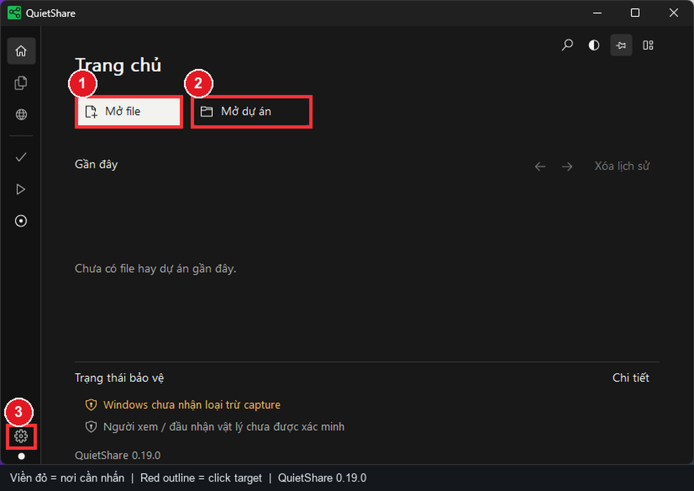
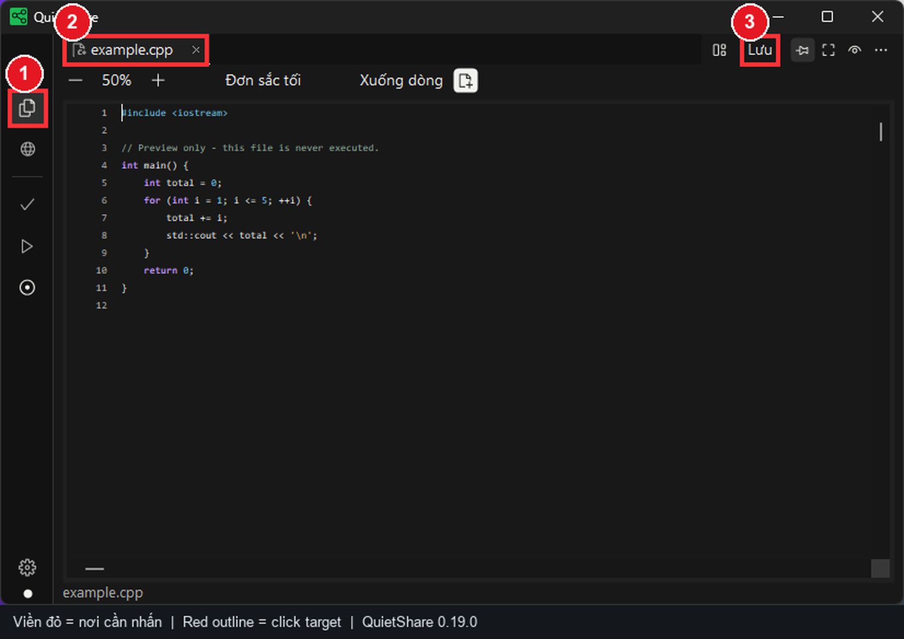
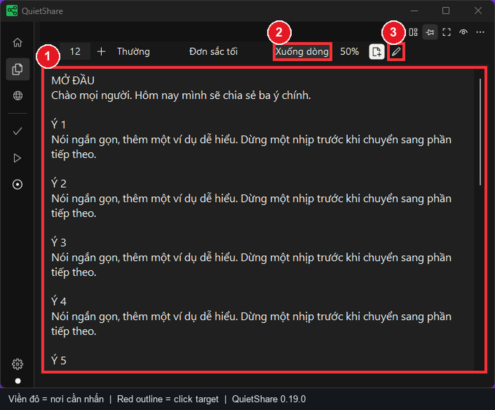
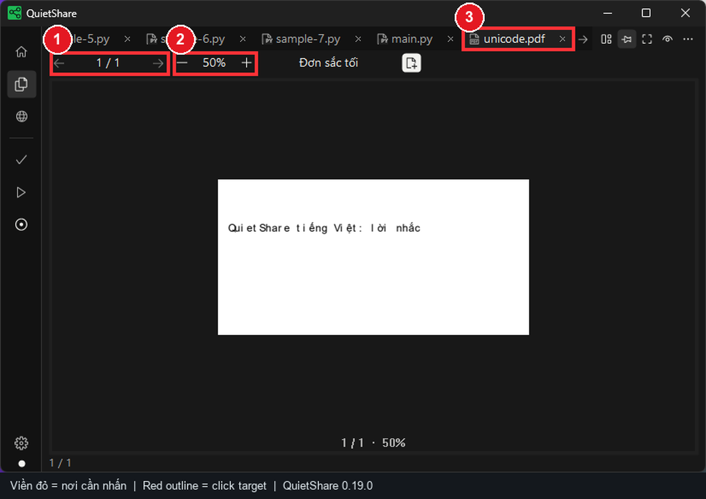
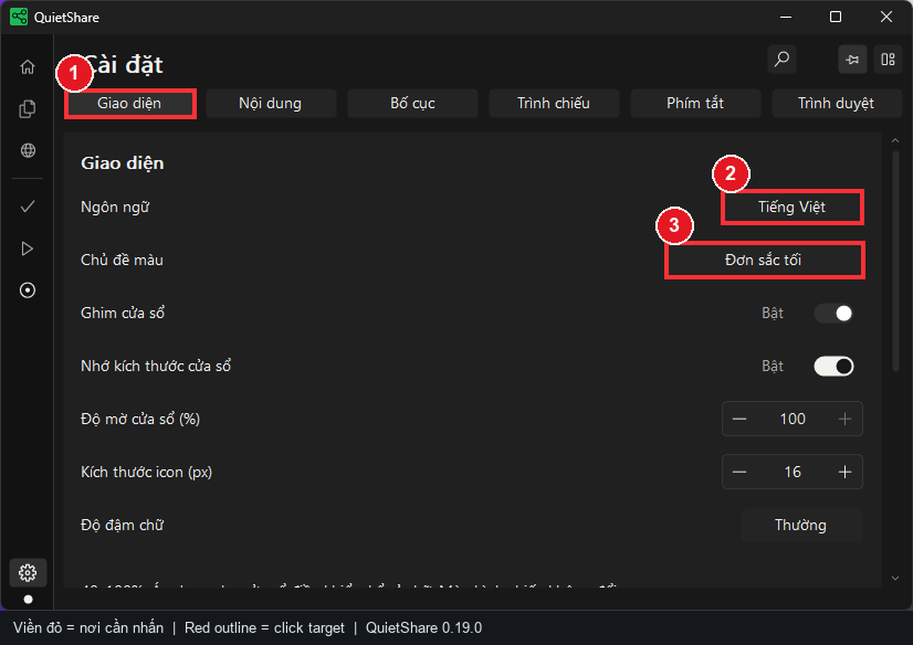
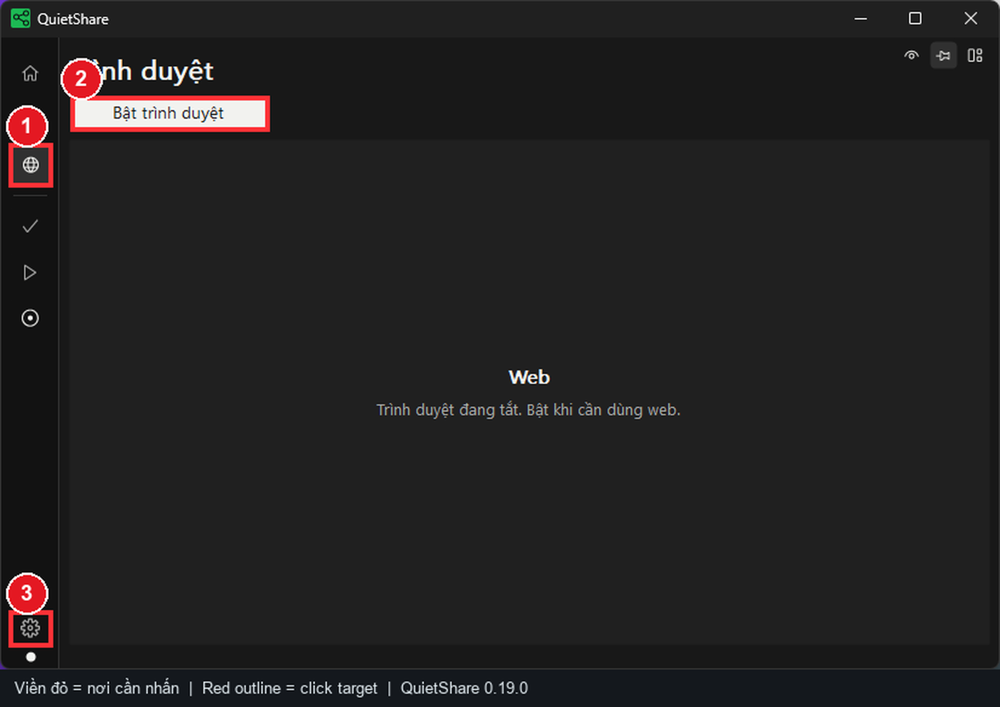
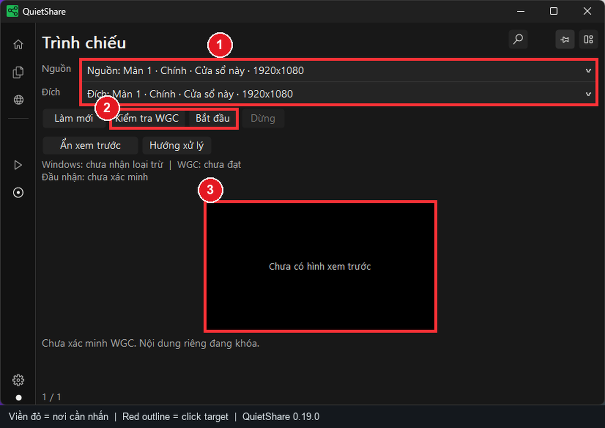
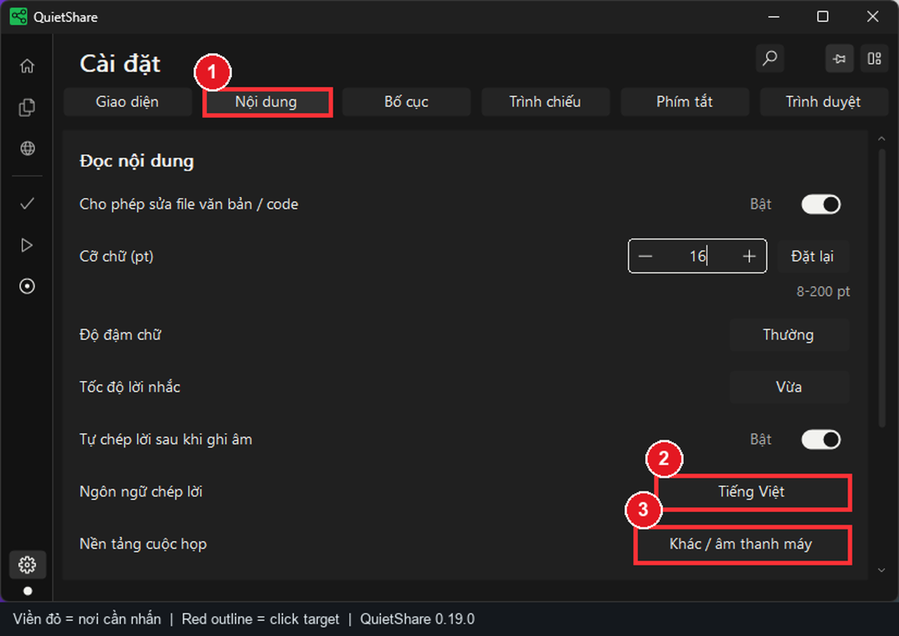

# QuietShare - Illustrated step-by-step guide (English)

> **Screenshot version:** QuietShare 0.19.0, real local UI test captures dated November 2, 2026. **Numbered red outlines** were added to point out controls. Locations may change with display scale, window size, language or release. The screenshots are not synthetic mockups.

**Jump to:** [Install](#1-download-and-install) · [Home and files](#2-home-and-opening-content) · [Script](#4-write-a-script-and-auto-scroll) · [PDF](#5-view-and-search-pdfs) · [Mirror](#8-safe-smart-mirror-projection) · [Recording](#9-record-and-transcribe-meetings)

QuietShare is a **private presenter panel** for scripts, local documents and optional web content. Its Smart Mirror feature requires verified protection checks. **Documentation screenshots are not proof that your actual audience output is private.**

## 1. Download and install

1. Go to the project's [official GitHub Releases](https://github.com/TDUmii/QuietShare/releases/latest) and choose the Windows x64 package.
2. For installation, download `QuietShare-Setup.exe`, launch it and follow the installer. Per-user installation is designed to work without administrator rights.
3. For portable use, download the ZIP and **extract all its files** together. Do not run only `QuietShare.exe` from inside the ZIP: bundled DLLs must remain alongside it.
4. Open QuietShare and locate the Home screen. Avoid repackaged installers from unknown senders.
5. Close the application before updating. back up important local material first.

**Requirements:** Windows 10 2004 (build 19041) or newer, or Windows 11, x64. Embedded browsing needs WebView2 Runtime. Smart Mirror requires **two distinct Extend displays**, not Duplicate.

## 2. Home and opening content

Home has compact actions above a full-width recent list and a separate protection section. **Open file** is the primary button and **Open project** uses an outline. Use the Home light/dark switch to move quickly between Monochrome dark and Monochrome light.

1. **Red 1 - Open file:** click **Mở file / Open file**, or press `Ctrl+O`, to open supported text, code, images or PDFs.
2. **Red 2 - Open project:** click **Mở dự án / Open project**, or `Ctrl+Shift+O`, to choose a local source folder.
3. **Red 3 - Settings:** use the gear in the bottom-left corner to change content, appearance, display projection and shortcuts.
4. **Recent** shows previously opened items. Removing a history entry does **not** delete its original file.
5. Read **Protection status** on Home. Unverified protection must not be interpreted as a safe external output.

## 3. Switch, edit and save documents

1. **Red 1 - Open files:** choose the documents icon in the left sidebar. `Ctrl+B` toggles the Explorer.
2. **Red 2 - Document tab:** select the tab of the file you wish to read or edit.
3. **Red 3 - Save:** click **Lưu / Save** or press `Ctrl+S` after changing text or code. QuietShare is a viewer/editor, **not a code runner**.
4. If editing is blocked, check **Settings > Reading/Content > Allow text/code editing**. Image and PDF viewers remain read-only.
5. If another application changed the file, resolve the reload/conflict prompt before saving.

## 4. Write a script and auto-scroll

1. Right-click **Open files** in the sidebar and choose **Compose script**. Scripts auto-save locally and remain separate from imported files.
2. **Red 1 - Reading/editor region:** enter short sections. With the reading area focused, press **Space** to start/pause auto-scroll.
3. **Red 2 - Word wrap:** enable **Wrap / Xuống dòng** to keep lines in view. Set a comfortable text size, weight and reading speed.
4. **Red 3 - Pen/edit control:** use the edit mode control to prepare text. `Ctrl+Enter` switches between reading and editing.
5. Press `F11` for focus mode when you need fewer distractions. Test the scroll speed before a live presentation.

## 5. View and search PDFs

1. Open a PDF from Home or with `Ctrl+O`.
2. **Red 1 - Page controls:** use previous/next and watch the current/total page count.
3. **Red 2 - Zoom:** press **- / +** or use `Ctrl+mouse wheel`. Fit Width is available in the overflow menu.
4. **Red 3 - PDF tab:** select it to return to the document among other tabs.
5. Search with `Ctrl+F`. use `Enter` / `Shift+Enter` for next/previous and `Esc` to dismiss. Text selection and search require an existing text layer. a scanned image-only PDF may not be searchable.
6. On a zoomed/tall PDF page, the wheel scrolls inside the page before continuing to the next page at its edge. Page Up / Page Down and arrows also navigate pages.

## 6. Appearance, language and layout

1. Click the bottom-left gear, then **red 1 - Appearance / Giao diện**.
2. **Red 2 - Language:** choose the UI language (Vietnamese or English).
3. **Red 3 - Color theme:** choose a built-in theme or custom palette. Use high-contrast options if needed.
4. The same page offers always-on-top, remember-window-size, opacity and icon size. Opacity is a controller appearance setting, **not a privacy guarantee**.
5. Use the Content/Reading tab to configure editing, text size and reading speed. Layout controls the visible bars.

## 7. Optional embedded browser

1. **Red 1 - Globe:** select the **Browser / Trình duyệt** area in the left sidebar.
2. **Red 2 - Enable browser:** enable it only when required. If prompted, install Microsoft's official WebView2 Runtime.
3. **Red 3 - Settings:** open **Settings > Browser** for sound, camera and microphone options.
4. Once enabled, type a URL or search term in a new tab. Up to eight browser tabs are supported. Browsing **starts disabled each time the application opens**.
5. Enable camera/microphone only when required and after checking the active site. Do not assume that web content has the same privacy properties as local files.

## 8. Safe Smart Mirror projection

**Preflight:** connect two different displays. Press `Win+P` and choose **Extend**. Keep QuietShare fully on the selected source display.

1. **Red 1 - Source and target:** select two different displays. Use **Refresh** after reconnecting HDMI or changing display mode.
2. **Red 2 - Verify and start:** select **Verify WGC**, then **Start**. The app checks protection before creating output. Failed starts show a handbook code. Select **Recovery** for the next action.
3. **Red 3 - Outgoing preview:** this area shows frames successfully sent by QuietShare, up to 10 FPS. The QA screenshot has no outgoing frame because this host has one display. **Hide preview** stops its renderer.
4. Inspect the actual projector, TV or meeting receiver. A local preview and Windows capture exclusion do not verify the physical audience output.
5. Select **Stop** when finished. After a display or safety change, restore the setup, verify again and explicitly start output.

**Quick switch:** press **Ctrl+K** to find a document, web tab, command or saved presentation set. Choose **Presentation sets** to save a named collection after saving edited files. The full manual explains replacement confirmation, missing paths and script recovery.

## 9. Record and transcribe meetings

1. Open **Settings** and select **red 1 - Content / Nội dung**.
2. **Red 2 - Transcription language:** select Vietnamese or English according to the speaker.
3. **Red 3 - Meeting platform:** choose the appropriate source, such as **Other / system audio**.
4. Return to **Recording** (circular sidebar icon), choose an output folder, optionally keep WAV files, then explicitly start and stop recording.
5. Recording uses **Windows playback audio** rather than automatically opening the microphone. It does not automatically record without user action. Import provider-exported VTT/TXT for Teams, Zoom or Meet if you want their speaker labels preserved.
6. Obtain any required participant notice/consent before recording and follow applicable privacy rules.

## 10. Before every session

- [ ] Open a sample document, PDF and image.
- [ ] Test `Space`, `Ctrl+Enter`, wrap and scroll speed if using a script.
- [ ] Test the embedded browser and the requested website if needed.
- [ ] For projection: Extend, distinct monitors, WGC check, real output inspection, then check again after any cable/display change.
- [ ] For recording: check the language, output folder and exported result.
- [ ] Note any `QS-P...` error code with app version and display configuration.

## 11. Troubleshooting checklist

| Symptom | Check |
|---|---|
| File cannot open | File path, access permissions and supported format |
| Cannot edit text/code | **Settings > Content > Allow editing**. PDF and images are read-only |
| PDF text search does not work | Whether the file contains selectable text or only scanned pages |
| Web page is unavailable | WebView2 installation, networking and browser-enabled status |
| Projection **Start** is disabled | `Win+P > Extend`, distinct source/destination, completed WGC verification |
| Projection stopped after an event | Read the error code, restore displays and verify protection again |
| Empty transcript | Windows playback audio, language choice, recording state and saved output |

Additional references: [Full English manual](USER_MANUAL_EN.md) · [Short user guide](USER_GUIDE.md) · [Privacy and projection](PRIVACY.md) · [Troubleshooting](TROUBLESHOOTING.md) · [Vietnamese illustrated guide](VISUAL_GUIDE_VI.md).
