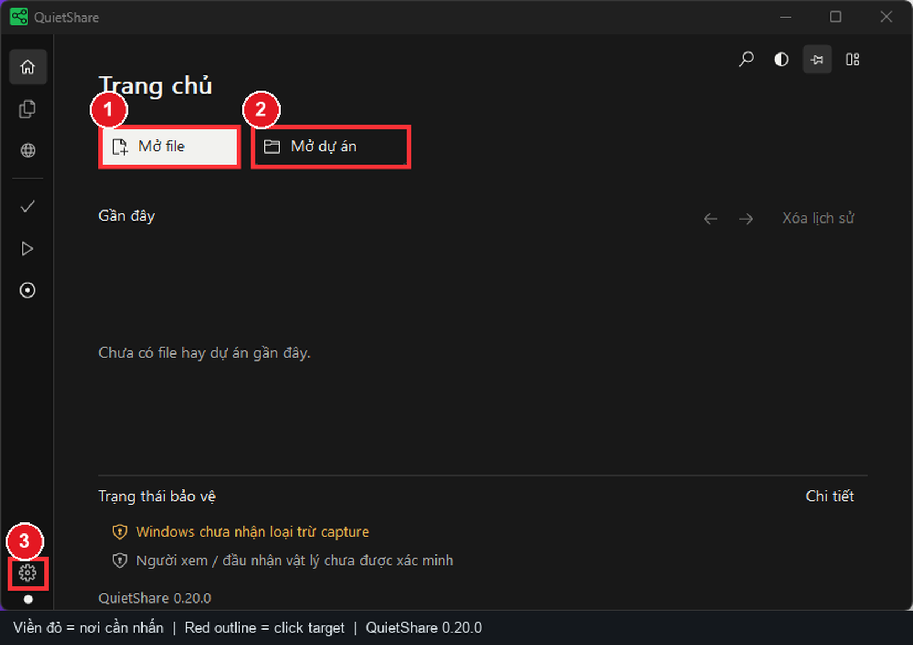
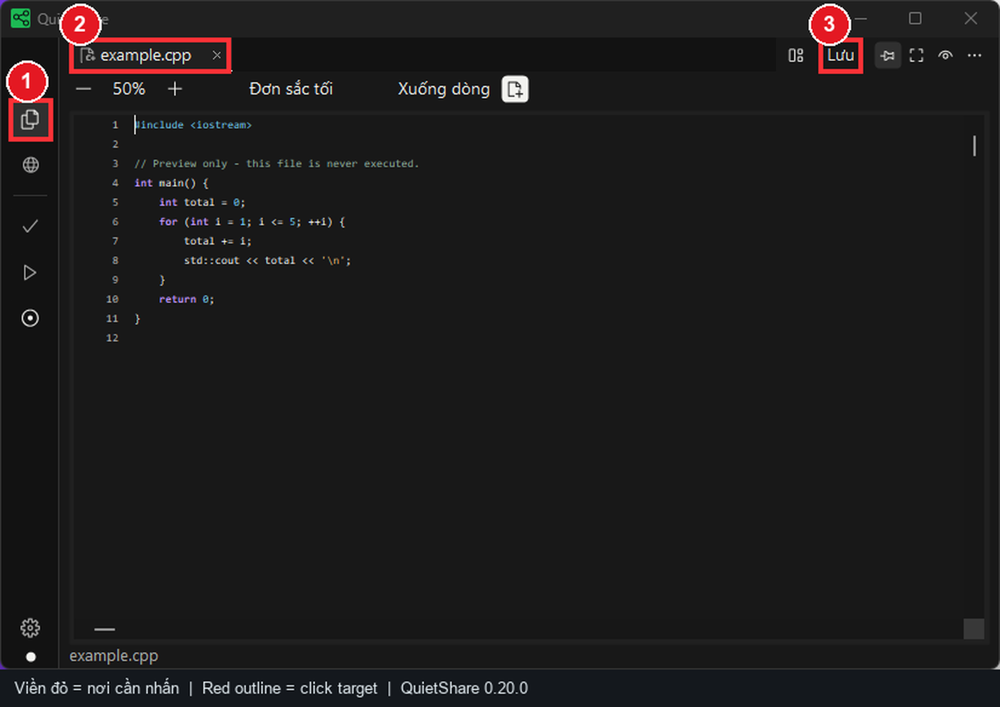
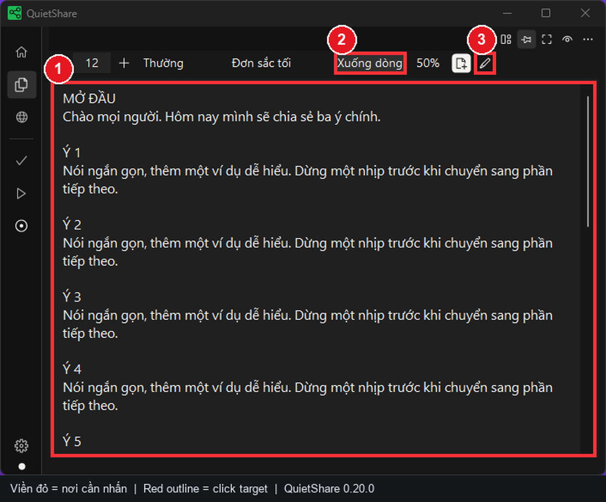
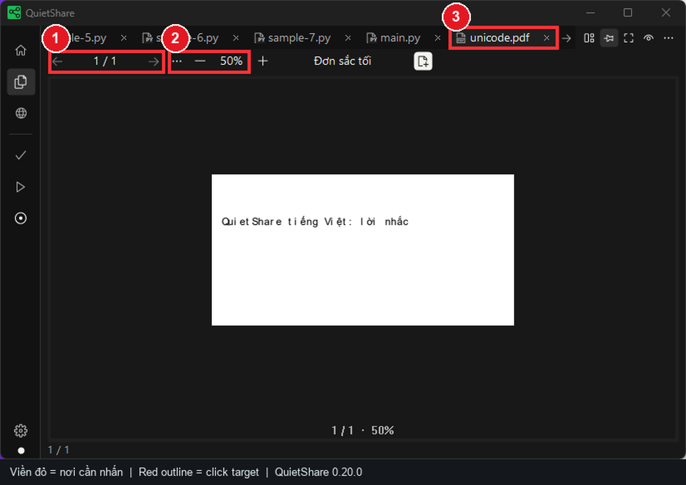
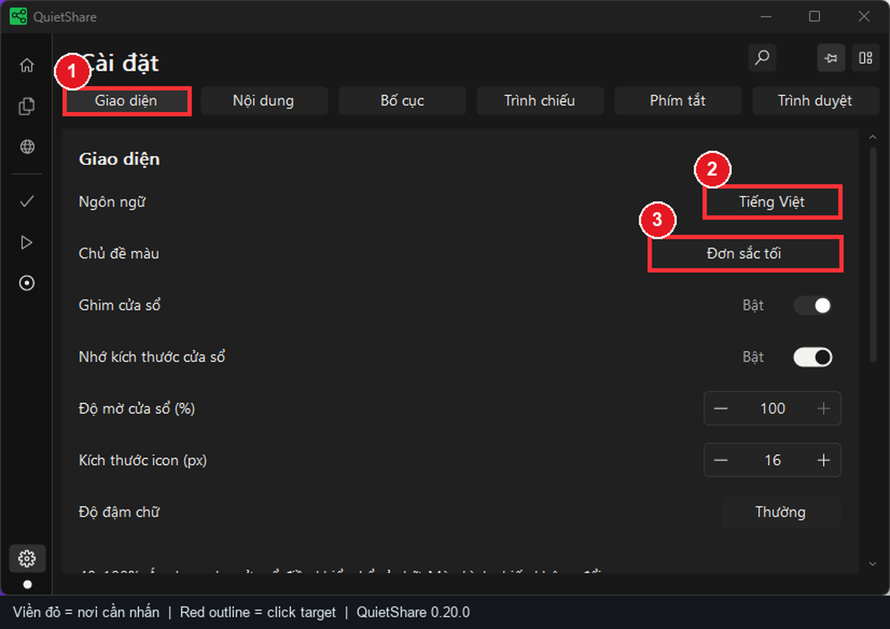
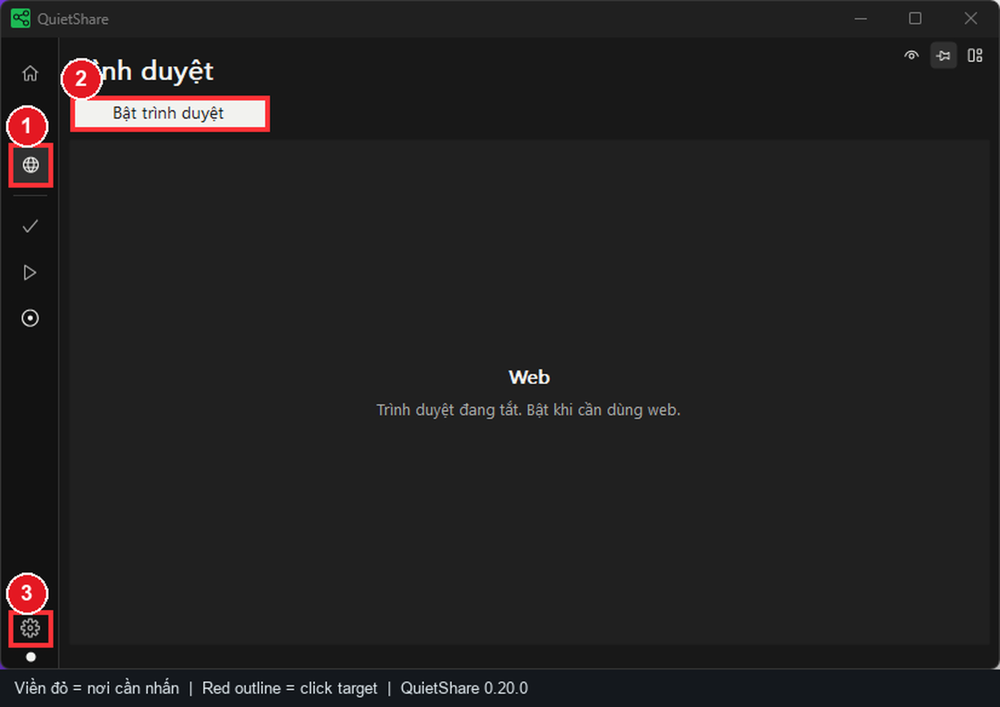
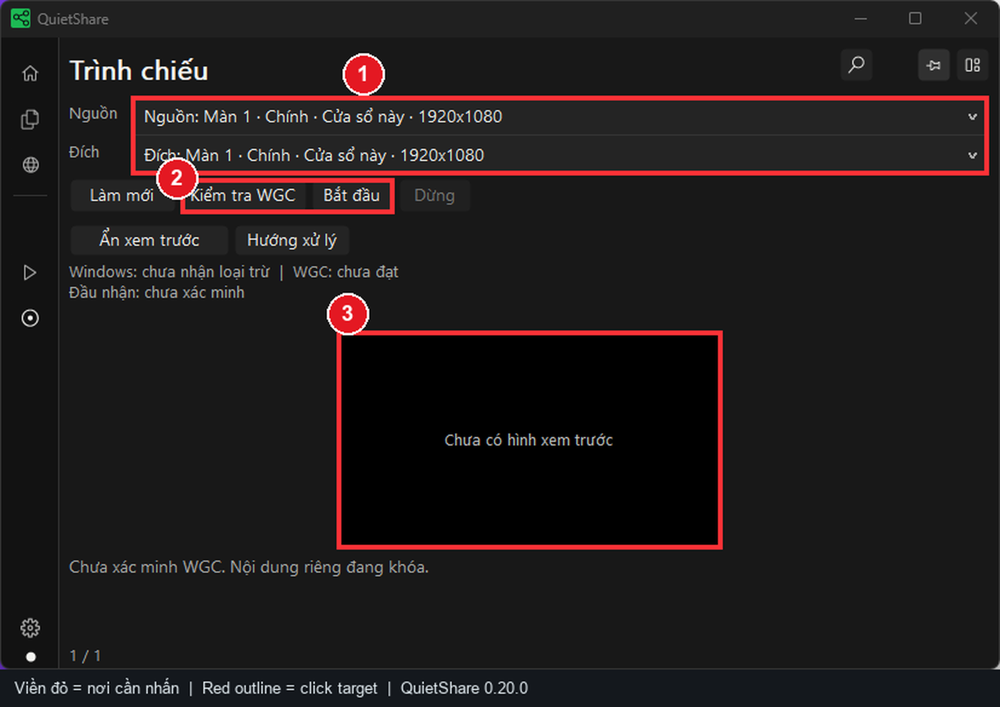
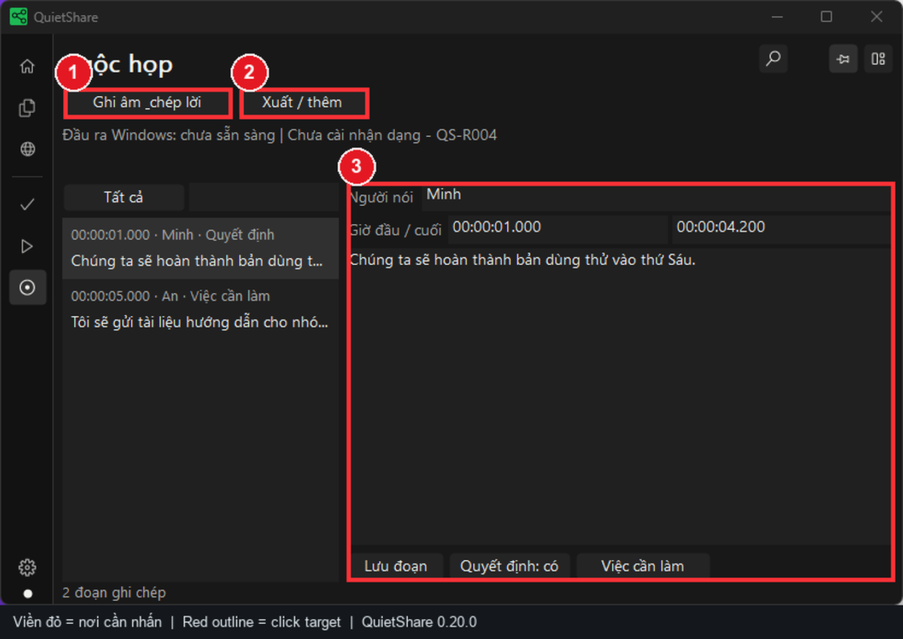

# QuietShare - Hướng dẫn bằng hình ảnh (Tiếng Việt)

> **Phiên bản ảnh:** QuietShare 0.20.0, chụp từ bài kiểm thử UI ngày 2/11/2026. Các **khung đỏ đánh số** được thêm vào sau khi chụp để chỉ vị trí nhấn. Tùy kích thước cửa sổ, ngôn ngữ và phiên bản, vị trí nút có thể thay đổi. Các ảnh không phải giao diện giả lập.

**Bắt đầu nhanh:** [Cài đặt](#1-tải-và-cài-đặt) · [Mở file](#2-trang-chủ-và-mở-dữ-liệu) · [Lời nhắc](#4-soạn-lời-nhắc-và-cuộn-tự-động) · [PDF](#5-đọc-pdf-và-tìm-kiếm) · [Trình chiếu](#8-trình-chiếu-smart-mirror-an-toàn) · [Ghi âm](#9-ghi-âm-và-chép-lời-cuộc-họp)

Đọc trước: QuietShare là **bảng điều khiển riêng** để xem lời nhắc và tài liệu khi trình bày. Tính năng chiếu màn hình (Smart Mirror) chỉ hoạt động khi các điều kiện bảo vệ được kiểm tra thành công. **Không dùng ảnh chụp trong hướng dẫn làm bằng chứng bảo vệ màn hình ngoài đời thực.**

## 1. Tải và cài đặt

1. Vào [GitHub Releases](https://github.com/TDUmii/QuietShare/releases/latest), chọn bản phát hành phù hợp với Windows x64.
2. Với **bộ cài**, tải tệp `QuietShare-Setup.exe`, mở tệp và làm theo hướng dẫn. Ứng dụng cài cho người dùng hiện tại, không yêu cầu tài khoản quản trị theo thiết kế.
3. Với **portable**, tải ZIP tương ứng rồi **giải nén toàn bộ** vào một thư mục. Không chạy riêng `QuietShare.exe` từ trong ZIP, vì cần các thư viện nằm cùng thư mục.
4. Khởi động QuietShare và xem **Trang chủ**. Chỉ lấy tệp từ Releases của repository chính thức. không cài bản được gửi lại từ nguồn không rõ.
5. Khi nâng cấp, đóng ứng dụng trước, sau đó chạy bộ cài mới hoặc thay toàn bộ thư mục portable. Nếu sử dụng dữ liệu quan trọng, nên có bản sao lưu trước khi nâng cấp.

**Yêu cầu:** Windows 10 từ bản 2004 (build 19041) hoặc Windows 11, x64. Trình duyệt nhúng cần WebView2 Runtime. Smart Mirror cần hai màn hình riêng ở chế độ Extend (không dùng Duplicate).

## 2. Trang chủ và mở dữ liệu

Trang chủ có các thao tác gọn phía trên danh sách gần đây toàn chiều rộng và khu vực bảo vệ riêng. **Mở file** là nút chính, **Mở dự án** dùng nút viền. Dùng nút chuyển sáng/tối trên Trang chủ để đổi nhanh giữa Đơn sắc tối và Đơn sắc sáng.

1. **Khung đỏ 1 - Mở file:** nhấn **Mở file** trên trang chủ hoặc `Ctrl+O`, chọn file văn bản, code, PDF hoặc ảnh từ máy tính.
2. **Khung đỏ 2 - Mở dự án:** nhấn **Mở dự án** hoặc `Ctrl+Shift+O` để chọn thư mục mã nguồn. Có thể duyệt thư mục và mở từng file bên trong.
3. **Khung đỏ 3 - Cài đặt:** nhấn biểu tượng bánh răng ở góc trái dưới để điều chỉnh nội dung, giao diện, trình chiếu và các phím tắt.
4. Mục **Gần đây** hiển thị file hoặc dự án bạn từng mở. Khi xóa mục khỏi lịch sử, file gốc **không bị xóa**.
5. Chú ý phần **Trạng thái bảo vệ** ở cuối trang chủ: chưa được xác minh thì **không** hiểu là đã an toàn khi chia sẻ.

## 3. Chuyển file, chỉnh sửa và lưu

1. **Khung đỏ 1 - Tệp đang mở:** chọn biểu tượng hai tờ giấy ở thanh trái để đến khu vực tài liệu. `Ctrl+B` bật/tắt trình duyệt thư mục.
2. **Khung đỏ 2 - Tab:** nhấn vào tên file cần xem. Khi nhiều file được mở, dùng thanh tab để chuyển qua lại.
3. **Khung đỏ 3 - Lưu:** nhấn **Lưu** hoặc `Ctrl+S` sau khi sửa văn bản/code. QuietShare xem code như văn bản, **không chạy mã nguồn**.
4. Nếu không thể chỉnh sửa, kiểm tra **Cài đặt > Nội dung > Cho phép sửa file văn bản / code**. PDF và ảnh vẫn là loại chỉ đọc.
5. Nếu file đã bị thay đổi từ ứng dụng khác, xử lý cảnh báo tải lại/giữ nội dung trước khi lưu. không cố ghi đè một phiên bản chưa kiểm tra.

## 4. Soạn lời nhắc và cuộn tự động

1. Trong khu vực **Tệp đang mở**, nhấp chuột phải và chọn **Soạn lời nhắc** (Compose script). Lời nhắc được lưu cục bộ, độc lập với file nhập vào.
2. **Khung đỏ 1 - Vùng soạn/đọc:** nhập nội dung theo từng đoạn ngắn. khi đọc, đặt con trỏ vào vùng này rồi nhấn **Space** để bắt đầu/tạm dừng cuộn tự động.
3. **Khung đỏ 2 - Xuống dòng:** nhấn **Xuống dòng** để văn bản không tràn chiều ngang. Điều chỉnh cỡ chữ, độ đậm và tốc độ cuộn theo khoảng cách nhìn.
4. **Khung đỏ 3 - Chế độ soạn:** biểu tượng bút cho phép nhận biết/chuyển chế độ soạn văn bản. Phím `Ctrl+Enter` chuyển qua lại giữa soạn và đọc.
5. Nhấn `F11` để tập trung vào nội dung nếu muốn giảm bớt thanh điều khiển. Kiểm tra lại nội dung trước lúc trình bày.

**Gợi ý:** Dùng câu ngắn, xuống dòng giữa các ý và thử tốc độ cuộn trước khi họp. đừng dựa vào một tốc độ duy nhất cho mọi bài nói.

## 5. Đọc PDF và tìm kiếm

1. Mở PDF với **Mở file** hoặc `Ctrl+O`.
2. **Khung đỏ 1 - Trang:** hai nút mũi tên trước/sau cho phép đổi trang. vùng ở giữa thể hiện **trang hiện tại / tổng số trang**.
3. **Khung đỏ 2 - Thu phóng:** nhấn **- / +** để chỉnh zoom. có thể dùng `Ctrl+con lăn`. Menu mở rộng hỗ trợ tùy chọn vừa chiều ngang.
4. **Khung đỏ 3 - Tab PDF:** nhấn tab tên PDF để quay lại khi đang mở nhiều file.
5. `Ctrl+F` để tìm văn bản, `Enter` để tìm tiếp, `Shift+Enter` để tìm trước và `Esc` để đóng ô tìm kiếm. Tìm/sao chép chỉ hoạt động khi PDF có **lớp chữ**. PDF scan dạng ảnh có thể không tìm được.
6. Khi phóng to, con lăn cuộn trong trang. khi đã tới mép trang, cuộn thêm mới chuyển trang. Có thể sử dụng Page Up/Page Down hoặc phím mũi tên trong vùng PDF.

## 6. Chỉnh giao diện, ngôn ngữ và bố cục

1. Mở biểu tượng bánh răng ở thanh trái. **khung đỏ 1** chọn tab **Giao diện**.
2. **Khung đỏ 2 - Ngôn ngữ:** chọn tiếng Việt hoặc tiếng Anh cho nhãn điều khiển.
3. **Khung đỏ 3 - Chủ đề màu:** chọn theme có sẵn hoặc tùy chỉnh màu. Nếu chữ khó đọc, đổi sang theme có tương phản cao.
4. Bên dưới còn có ghim cửa sổ trên cùng, nhớ kích thước, độ mờ và kích thước biểu tượng. Độ mờ ảnh hưởng đến **cửa sổ điều khiển**. không dùng độ mờ làm biện pháp bảo mật.
5. Tab **Nội dung** cho phép bật/tắt sửa file, chỉnh cỡ chữ và tốc độ lời nhắc. Tab **Bố cục** điều chỉnh các thanh điều khiển.

## 7. Bật trình duyệt tùy chọn

1. **Khung đỏ 1 - Biểu tượng quả địa cầu:** mở trang **Trình duyệt** trên thanh bên.
2. **Khung đỏ 2 - Bật trình duyệt:** chỉ bật khi thực sự cần website. Nếu ứng dụng báo thiếu WebView2 Runtime, cài bản chính thức của Microsoft.
3. **Khung đỏ 3 - Cài đặt:** mở **Cài đặt > Trình duyệt** để xem tùy chọn âm thanh, camera và micro.
4. Khi đã bật, nhập địa chỉ web hoặc từ khóa vào tab mới. sử dụng các tab để chuyển trang. Trình duyệt giới hạn tối đa 8 tab và **mặc định tắt khi khởi động ứng dụng**.
5. Cấp quyền camera/micro chỉ khi thực sự cần và bạn đã kiểm tra trang đang sử dụng. Đừng giả định mọi trang web được chặn theo cùng một cơ chế với nội dung cục bộ.

## 8. Trình chiếu Smart Mirror an toàn

**Chuẩn bị:** kết nối hai màn hình khác nhau. Nhấn `Win+P`, chọn **Extend / Mở rộng**. Đặt toàn bộ QuietShare trong màn nguồn đã chọn.

1. **Khung đỏ 1 - Nguồn và đích:** chọn hai màn khác nhau. Bấm **Làm mới** sau khi cắm lại HDMI hoặc đổi chế độ màn hình.
2. **Khung đỏ 2 - Kiểm tra và bắt đầu:** bấm **Kiểm tra WGC**, rồi **Bắt đầu**. Ứng dụng kiểm tra bảo vệ trước khi tạo đầu ra. Nếu lỗi, đọc mã trong book và bấm **Hướng xử lý**.
3. **Khung đỏ 3 - Xem trước luồng đang gửi:** vùng này hiển thị các hình QuietShare đã gửi thành công, tối đa 10 FPS. Ảnh QA chưa có hình vì máy kiểm thử chỉ có một màn. **Ẩn xem trước** dừng bộ dựng hình của khung.
4. Quan sát máy chiếu, TV hoặc phía người nhận cuộc họp. Khung xem trước cục bộ và Windows nhận loại trừ capture không xác minh được hình ảnh thực tế bên ngoài.
5. Bấm **Dừng** khi kết thúc. Sau thay đổi màn hình hay lỗi bảo vệ, khôi phục cấu hình, kiểm tra lại và chủ động bắt đầu.

**Chuyển nhanh:** nhấn **Ctrl+K** để tìm tài liệu, tab web, lệnh hoặc bộ thuyết trình. Chọn **Bộ thuyết trình** để lưu một bộ có tên sau khi lưu các file đang sửa. Hướng dẫn đầy đủ có quy trình xác nhận thay tab, xử lý file đổi đường dẫn và khôi phục lời nhắc.

## 9. Ghi âm và chép lời cuộc họp

1. Mở **Cuộc họp** bằng icon tròn ở thanh bên. Trước tiên chọn ngôn ngữ, thư mục xuất và Whisper cục bộ tùy chọn tại **Cài đặt > Nội dung**. Mặc định chọn Small (466 MiB). Chỉ tải khi chủ động Cài.
2. **Khung đỏ 1:** tự bắt đầu hoặc dừng ghi âm. Nguồn là âm thanh phát Windows. Ứng dụng không mở micro hoặc tự ghi.
3. **Khung đỏ 2:** mở Xuất / thêm để kiểm tra cài đặt, nhập transcript Teams/Zoom/Meet hoặc xuất TXT, VTT có giờ và biên bản. Dừng xử lý hiện khi đang xử lý.
4. **Khung đỏ 3:** duyệt và sửa đoạn, người nói và mốc giờ. Đánh dấu quyết định/việc cần làm rồi lưu. Cửa sổ nhỏ chuyển giữa Các đoạn / Nội dung / Người-giờ.
5. Transcript nền tảng giữ tên người nói có sẵn. Nhận dạng âm thanh trộn không suy đoán tên. Âm thanh nằm trên máy. Hãy xuất ghi chép quan trọng trước khi nhập phiên khác.
6. Kiểm tra quyền riêng tư, thông báo và sự đồng ý của người tham gia theo quy định áp dụng trước khi ghi.

## 10. Kiểm tra trước buổi thuyết trình

- [ ] Thử mở một file văn bản/code, PDF và một ảnh.
- [ ] Nếu dùng lời nhắc, thử nút xuống dòng, `Space`, `Ctrl+Enter` và tốc độ cuộn.
- [ ] Nếu dùng website, thử bật trình duyệt và tải trang trước giờ trình bày.
- [ ] Nếu dùng chiếu, chọn **Extend**, hai màn hình khác nhau, kiểm tra WGC, xem đầu ra người xem và kiểm tra lại sau mỗi thay đổi kết nối.
- [ ] Nếu cần ghi âm, thử ngôn ngữ, thư mục lưu và đọc lại tệp được tạo.
- [ ] Nếu hiển thị mã lỗi, ghi lại **mã QS-P...**, bước đang làm, trạng thái màn hình và phiên bản ứng dụng.

## 11. Khi gặp sự cố

| Hiện tượng | Cách xử lý |
|---|---|
| Không mở được file | Kiểm tra đường dẫn và quyền đọc. thử file nhỏ, định dạng được hỗ trợ |
| Không chỉnh sửa được code/text | Kiểm tra **Cài đặt > Nội dung > Cho phép sửa**. PDF và ảnh là chỉ đọc |
| Không tìm được chữ trong PDF | Kiểm tra PDF có lớp text hay chỉ là ảnh scan |
| Trang web không tải | Kiểm tra WebView2 Runtime, kết nối và trạng thái bật trình duyệt |
| **Bắt đầu** trình chiếu bị khóa | Kiểm tra **Win+P > Extend**, nguồn/đích khác nhau, chạy WGC |
| Đang chiếu thì dừng | Xem mã lỗi, khôi phục màn hình và xác minh lại trước khi bắt đầu |
| Chép lời không có nội dung | Kiểm tra Windows đang phát âm thanh, cấu hình ngôn ngữ, trạng thái phiên ghi âm |

Tài liệu liên quan: [Hướng dẫn đầy đủ](USER_MANUAL_VI.md) · [Hướng dẫn ngắn](USER_GUIDE.md) · [Bảo vệ và trình chiếu](PRIVACY.md) · [Khắc phục sự cố](TROUBLESHOOTING.md) · [Bản tiếng Anh có ảnh](VISUAL_GUIDE_EN.md).
